# CHAPTER 2: SYSTEM ANALYSIS AND DESIGN

## 2.1 System Requirements

System analysis translated the operational problems of fragmented coursework distribution into explicit functional requirements, non-functional quality benchmarks, and hardware/software specifications aligned with the AWS Free Tier budget in `ap-southeast-1`.

### 2.1.1 Functional Requirements

Table 2.1 documents the core functional requirements implemented and verified across the authentication, administration, course management, cloud storage, grading, and learning-record modules of UE Cloudlearn.

**Table 2.1**  
*Functional Requirements Specification of UE Cloudlearn*

| Req ID | Module | Requirement Description | Target Role(s) |
|---|---|---|---|
| **FR-01** | Authentication | Allow new users to self-register as students with full name, unique lowercase email, and minimum 8-character password. | Public / Student |
| **FR-02** | Authentication | Authenticate existing active users via email and password, issuing a 24-hour signed JWT in an `HttpOnly`, `SameSite=Lax` cookie (`ue_cloudlearn_token`) or Bearer token. | All Roles |
| **FR-03** | Session & Logout | Verify active sessions via `GET /api/auth/me` against RDS user status (`active` vs. `inactive`) and clear session cookies on logout. | All Roles |
| **FR-04** | User Management | List users (filterable by `?role=`), create accounts with any role (`admin`, `instructor`, `student`), edit name/role/status, and delete accounts while blocking self-demotion or self-deletion. | Administrator |
| **FR-05** | Course Directory | List and search courses by code or title, scoped by `all`, `enrolled`, or `assigned`, displaying instructor name, active student count, and enrollment flag. | All Roles |
| **FR-06** | Course CRUD | Create courses with unique uppercase course codes (`course_code`), assign/reassign active instructors, update course descriptions/terms, and cascade-delete courses along with S3 objects. | Admin (full); Assigned Instructor (update) |
| **FR-07** | Enrollments | Allow students to self-enroll or drop enrollments (`DELETE /api/courses/:courseId/enroll`), reactivate previously dropped enrollments, and allow staff to inspect course rosters. | Student / Instructor / Admin |
| **FR-08** | Learning Materials | Upload course files (`multipart/form-data`, `<= 15 MB`) to Amazon S3 (`materials/course-{id}/...`), persist metadata in RDS, edit metadata or replace files, and delete both RDS rows and S3 objects. | Assigned Instructor / Admin |
| **FR-09** | Presigned Downloads | Generate 300-second (5-minute) Amazon S3 presigned GET URLs for materials, assignment attachments, and submissions strictly after JWT and course/owner authorization checks. | Enrolled Student / Assigned Instructor / Admin |
| **FR-10** | Assignments | Create, update, and delete course assignments with due dates, positive `max_score`, instructions, and optional reference file attachments in Amazon S3. | Assigned Instructor / Admin |
| **FR-11** | Submissions | Allow actively enrolled students to upload or replace ungraded assignment files (`submissions/assignment-{id}/student-{id}/...`) with optional notes, while blocking changes once graded (`409 ALREADY_GRADED`). | Enrolled Student |
| **FR-12** | Submission Deletion | Permit students to delete their own ungraded submissions (or admins to delete any submission), removing both the MySQL row and S3 object. | Student (ungraded own) / Admin |
| **FR-13** | Grading & Feedback | Filter staff submission queues (`?status=`, `?courseId=`), download student files via presigned URLs, and record numeric scores (`0 <= score <= maxScore`), feedback, `graded`/`returned` status, and `graded_at`. | Assigned Instructor / Admin |
| **FR-14** | Learning Records | Aggregate enrolled courses, assignments, submission statuses, scores, feedback, per-course averages, and overall average via multi-table SQL `JOIN` queries (`GET /api/records/me`). | Student |
| **FR-15** | Role Dashboards | Serve compact role-specific KPI summaries (`GET /api/dashboard/summary`) with 3 top KPIs and up to 5 recent items per list. | All Roles |
| **FR-16** | Health Monitoring | Expose public `GET /api/health` verifying live Express execution and RDS MySQL pool connectivity (`SELECT 1 AS ok`). | Public / DevOps |

### 2.1.2 Non-Functional Requirements

Table 2.2 summarizes the security, usability, reliability, and cost-efficiency non-functional requirements enforced across the system.

**Table 2.2**  
*Non-Functional Requirements Specification*

| Category | Non-Functional Requirement | Concrete Implementation Standard |
|---|---|---|
| **Security & Secrets** | Zero static secrets in source code or EC2 application disk | `.env` excluded via `.gitignore`; `bcryptjs` (10 rounds); JWT `HttpOnly` cookies; EC2 accesses S3 exclusively via IAM Role (`ue-cloudlearn-ec2-role`) and IMDSv2. |
| **Network Isolation** | Protect relational academic records from internet access | Amazon RDS placed in private subnets (`PubliclyAccessible = false`) with `ue-cloudlearn-rds-sg` accepting TCP `3306` only from `ue-cloudlearn-ec2-sg`. |
| **Storage Privacy** | Prevent unauthenticated public object enumeration or leaks | Amazon S3 enforces Block All Public Access (`4/4` flags `true`), SSE-S3 (`AES256`) default encryption, and 5-minute presigned GET URLs. |
| **SQL Transparency & Safety** | Immune to SQL injection while remaining auditable | Exclusively `mysql2/promise` parameterized `?` placeholders + `zod` schema validation; zero ORM abstraction layers. |
| **Usability & Accessibility** | Calm, responsive UI meeting accessibility baselines | WCAG AA contrast (`>= 4.5:1`), minimum `44x44px` hit areas on all interactive controls, sentence case everywhere, light/dark themes, and skeleton/empty/error/toast states. |
| **Performance & Memory** | Operate smoothly within 1 GB RAM Free Tier EC2 limits | Static Vite production bundle served by Nginx; 1 GB `/swapfile`; `NODE_OPTIONS="--max-old-space-size=768"` build guard; PM2 `max_memory_restart: 350M`. |
| **Cost Efficiency** | Maintain AWS Free Tier compliance (`$0.00` target) | Single `t3.micro` EC2, Single-AZ `db.t3.micro` RDS (`20 GB`), standard S3 (`< 5 GB`), zero NAT Gateway, zero ALB, zero unattached Elastic IP. |

### 2.1.3 Hardware and Software Specifications

Table 2.3 and Table 2.4 present the verified local development environment and deployed AWS production hardware/software specifications documented during production cloud deployment.

**Table 2.3**  
*Development and Cloud Server Hardware Specifications*

| Environment | Component | Verified Specification |
|---|---|---|
| **Local Development Workstation** | Host OS & Architecture | Microsoft Windows workstation running `git 2.55`, `Node.js v24.19.0`, `npm 11.17.0`, and `AWS CLI v2.40.2` (`ap-southeast-1`) |
| **Production Compute Host** | Amazon EC2 (`ue-cloudlearn-app-ec2`) | `t3.micro` (2 vCPU, 1 GiB RAM + 1 GB `/swapfile`), 20 GB `gp3` root EBS volume (`DeleteOnTermination = true`), `ap-southeast-1a` |
| **Production Relational DB** | Amazon RDS (`ue-cloudlearn-db`) | `db.t3.micro` (2 vCPU, 1 GiB RAM), Single-AZ, 20 GB `gp2` storage, private VPC subnets (`ap-southeast-1a`, `ap-southeast-1b`) |

**Table 2.4**  
*Software, Framework, and Cloud Service Specifications*

| Layer | Technology / Service | Verified Version / Configuration |
|---|---|---|
| **Operating System (EC2)** | Ubuntu Server 24.04 LTS | `ami-071c84f5b32b09602` (64-bit x86) |
| **Web Server & Reverse Proxy** | Nginx | `nginx/1.24.0` (`client_max_body_size 16M`, static SPA on `/`, proxy `/api/` to `127.0.0.1:5000`) |
| **Process Manager** | PM2 | `PM2 7.1.2` (`ue-cloudlearn-api`, systemd `pm2-ubuntu.service` enabled) |
| **Backend Runtime & API** | Node.js + Express.js | Node.js `v20.20.2` (EC2) / `v24.19.0` (local), Express `^4.21.2`, ES Modules (`"type": "module"`) |
| **Database Client & Validator** | `mysql2` + `zod` + `multer` | `mysql2 ^3.12.0` (`mysql2/promise`), `zod ^3.24.2`, `multer ^2.5.0` (15 MB memoryStorage) |
| **Security & Auth Libraries** | `bcryptjs`, `jsonwebtoken`, `helmet` | `bcryptjs ^2.4.3`, `jsonwebtoken ^9.0.2`, `cookie-parser ^1.4.7`, `helmet ^8.0.0`, `cors ^2.8.5` |
| **AWS SDK** | `@aws-sdk/client-s3` + Presigner | `@aws-sdk/client-s3 ^3.1172.0`, `@aws-sdk/s3-request-presigner ^3.1172.0` |
| **Frontend Stack** | React + TypeScript + Vite + Tailwind | React `^18.3.1`, TypeScript `^5.6.3`, Vite `^5.4.11`, Tailwind CSS `^3.4.15`, React Router `^6.28.0`, `lucide-react ^0.460.0` |
| **Testing Stack** | Vitest + Supertest | `vitest ^3.0.7`, `supertest ^7.0.0` (27 tests across 8 suites) |
| **Managed Cloud Services** | AWS (`ap-southeast-1`) | Amazon VPC, Amazon EC2, Amazon RDS (MySQL `8.0.46`), Amazon S3, AWS IAM |

---

## 2.2 System Architecture

UE Cloudlearn follows a decoupled multi-tier AWS web architecture designed to separate public web delivery from private relational persistence and encrypted cloud object storage. End-user browsers communicate over HTTP (TCP `80`) through the **Internet Gateway** (`ue-cloudlearn-igw`) to **Nginx** running on the EC2 instance inside the public subnet (`10.0.1.0/24`). Nginx delivers compiled React static assets (`frontend/dist`) directly and reverse-proxies `/api/*` requests over localhost to the **Express.js** backend managed by **PM2**. The Express API executes parameterized queries against **Amazon RDS MySQL 8.0.46** across private subnets (`10.0.2.0/24`, `10.0.3.0/24`) and interacts with **Amazon S3** over TLS (`443`) using temporary credentials supplied automatically by the **EC2 IAM Instance Profile** (`ue-cloudlearn-ec2-role`). Figure 2.1 illustrates this complete system architecture.

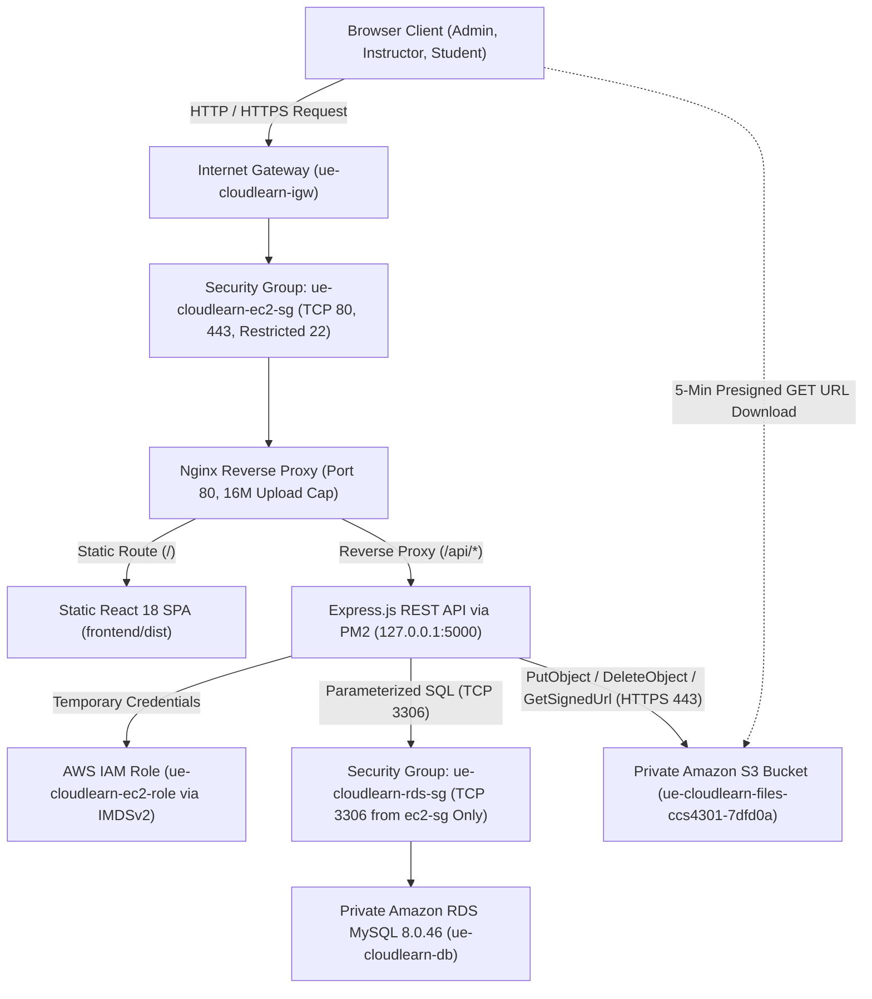

*Figure 2.1: UE Cloudlearn Multi-Tier AWS Cloud System Architecture Diagram.*

---

## 2.3 System Workflow

Operational flows within UE Cloudlearn diverge cleanly by authenticated user role after passing the shared authentication gate (`POST /api/auth/login` or `POST /api/auth/register`). Figures 2.2, 2.3, and 2.4 illustrate the complete execution workflows for Administrators, Instructors, and Students, respectively.

### 2.3.1 Administrator Workflow

Administrators oversee platform governance, user lifecycle management, and course-to-instructor assignment, as shown in Figure 2.2.

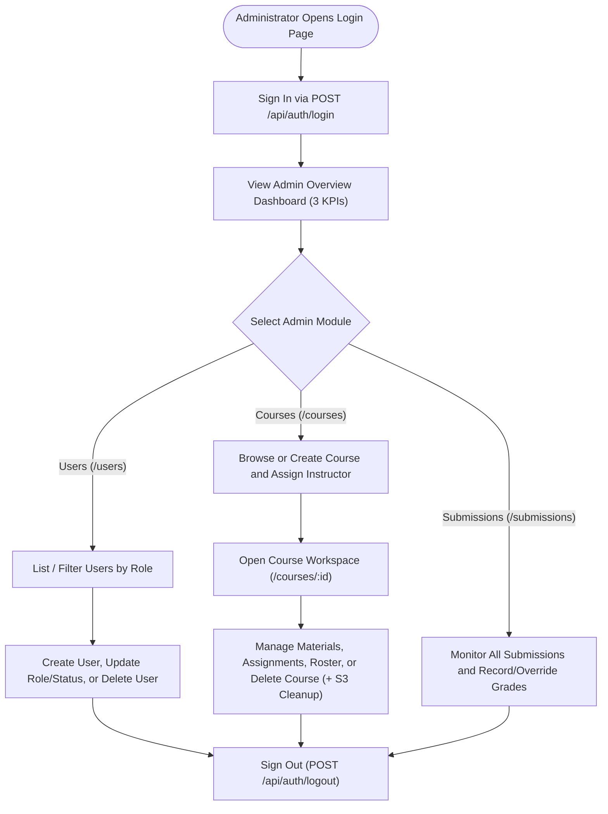

*Figure 2.2: Administrator Role System Workflow Flowchart.*

### 2.3.2 Instructor Workflow

Instructors manage assigned courses, upload lecture materials to Amazon S3, publish assignments, inspect enrolled rosters, download student deliverables via presigned URLs, and record scores and qualitative feedback. Figure 2.3 traces this end-to-end instructional workflow.

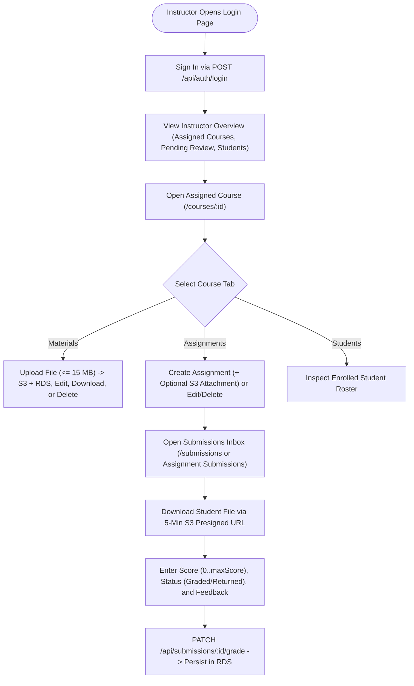

*Figure 2.3: Instructor Role System Workflow Flowchart.*

### 2.3.3 Student Workflow

Students register or sign in, discover courses, self-enroll, download course materials securely via presigned URLs, upload or update ungraded assignment submissions, and review consolidated grades and instructor feedback in Learning Records. Figure 2.4 maps the student lifecycle.

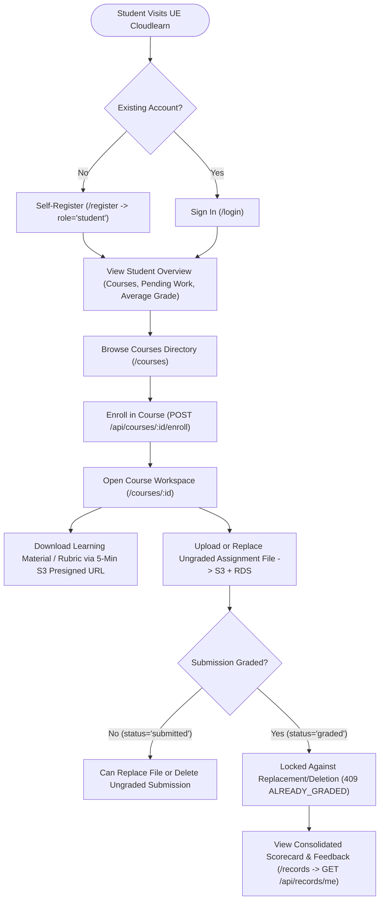

*Figure 2.4: Student Role System Workflow Flowchart.*

---

## 2.4 User Interface Design

The UE Cloudlearn frontend implements an institutional **UE Crimson** visual language paired with a minimalist, high-contrast responsive UI/UX design system defined in `frontend/src/styles/tokens.css`. Every screen focuses on one clear purpose and one primary action, avoids decorative clutter, eliminates emoji characters entirely in favor of consistent `lucide-react` inline SVG line icons (`strokeWidth={1.75}`), enforces sentence-case typography, and guarantees a minimum `44x44px` interactive hit area on every button, link, tab, toggle, and list row.

To preserve readability across ambient lighting conditions, all components bind exclusively to CSS custom properties defined once in `frontend/src/styles/tokens.css` supporting automatic system preference detection (`@media (prefers-color-scheme: dark)`) and persistent manual switching (`localStorage` key `ue_cloudlearn_theme`). Table 2.5 documents the exact color tokens and verified WCAG AA contrast pairings.

**Table 2.5**  
*UE Crimson Light and Dark Theme Color Tokens and WCAG AA Contrast Ratios*

| CSS Custom Property | Light Mode Value | Dark Mode Value | Design Purpose & Contrast Verification |
|---|---|---|---|
| `--bg-canvas` | `#F5F5F7` | `#141416` | Page background canvas |
| `--bg-surface` | `#FFFFFF` | `#1E1E21` | Elevated cards, sheets, sidebars, and inputs |
| `--bg-subtle` | `#ECECEF` | `#2A2A2E` | Icon wells, skeleton placeholders, secondary fill |
| `--bg-bar` | `rgba(245, 245, 247, 0.84)` | `rgba(20, 20, 22, 0.84)` | Frosted mobile sticky header and tab bar (`blur(20px)`) |
| `--text-primary` | `#1D1D1F` | `#F5F5F7` | Primary headings & body copy (`16.2:1` light / `15.8:1` dark on surface) |
| `--text-secondary` | `#636368` | `#A1A1A6` | Subtitles, metadata, timestamps (`5.9:1` light / `6.6:1` dark on surface) |
| `--border-hairline` | `#D2D2D7` | `#36363B` | `1px` dividers and input borders |
| `--accent` | `#A61C1C` | `#F27474` | Primary UE Crimson text links, active nav text & icons (`7.49:1` light / `5.03:1` dark) |
| `--accent-fill` | `#A61C1C` | `#B82222` | Filled primary buttons & progress bars (`7.49:1` light / `5.9:1` dark vs. `#FFFFFF`) |
| `--accent-hover` | `#8A1515` | `#9E1B1B` | Hover and active press state for filled primary buttons |
| `--accent-soft` | `rgba(166, 28, 28, 0.10)` | `rgba(242, 116, 116, 0.16)` | Active sidebar pill tint and focus ring glow |
| `--status-success-fg` / `bg` | `#1D6F34` / `#E8F6EC` | `#4ADE80` / `rgba(74, 222, 128, 0.16)` | Graded / Active / Success semantic badge & toast (`6.1:1` light) |
| `--status-warning-fg` / `bg` | `#8F5400` / `#FFF3E0` | `#FBBF24` / `rgba(251, 191, 36, 0.16)` | Pending / Due soon / Returned semantic status (`5.9:1` light) |
| `--status-error-fg` / `bg` | `#B42318` / `#FEE4E2` | `#FCA5A5` / `rgba(248, 113, 113, 0.18)` | Error / Overdue / Destructive confirmation tint (`6.2:1` light) |

Figures 2.5 through 2.8 showcase the live deployed user interface running at `http://47.131.249.155`, highlighting the centered authentication cards, calm dashboard KPIs, and adaptive dark mode theme parity.

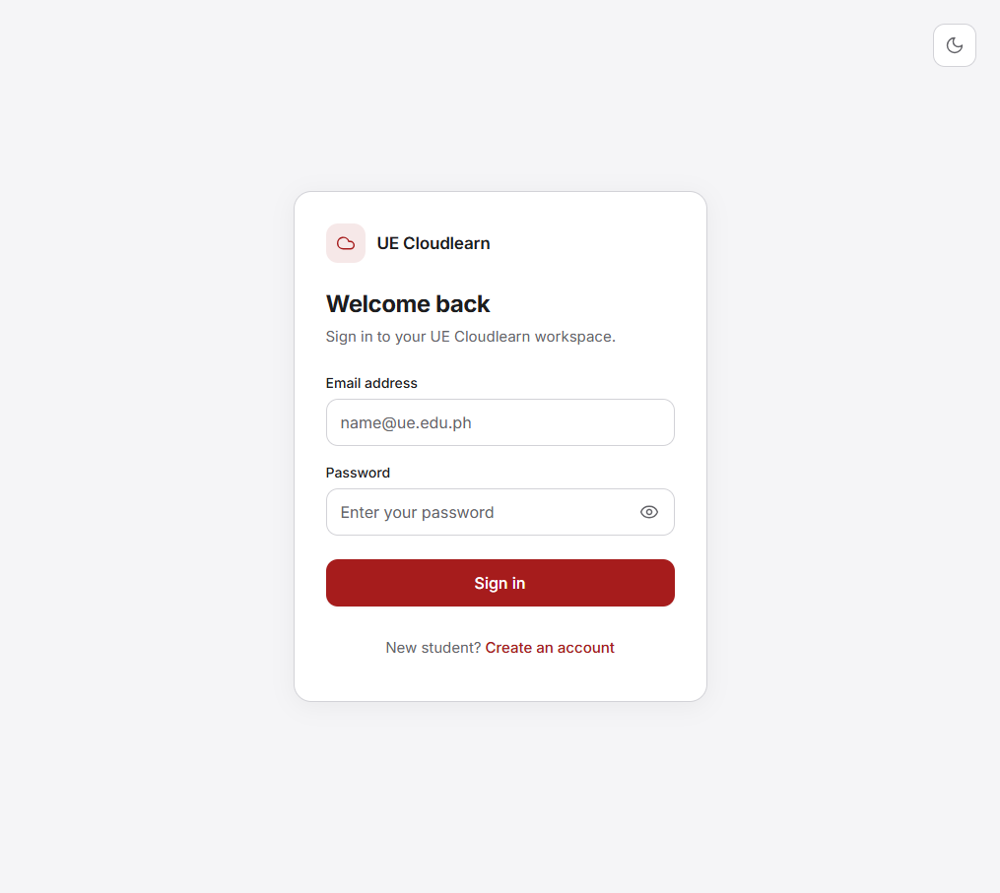

*Figure 2.5: UE Cloudlearn Sign In Interface (`/login`).*

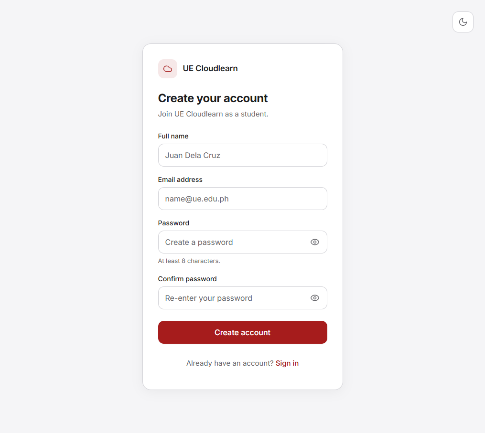

*Figure 2.6: UE Cloudlearn Student Registration Interface (`/register`).*

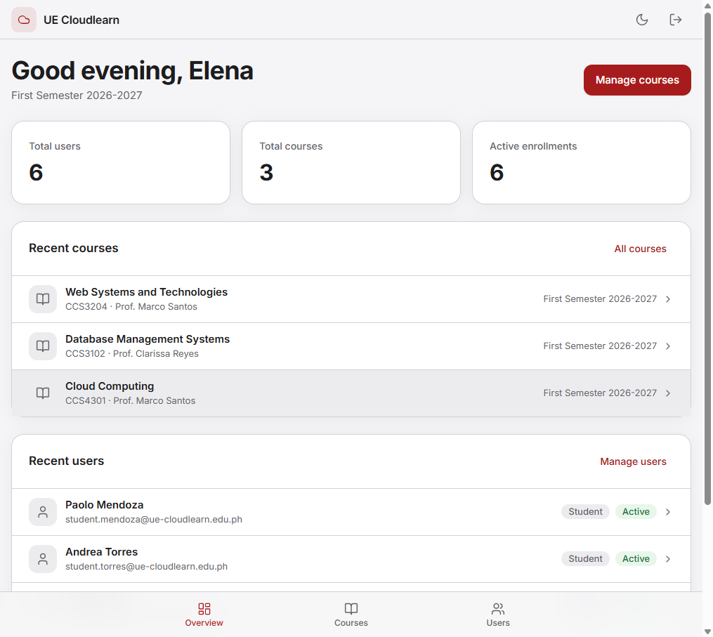

*Figure 2.7: Role Overview Dashboard Interface (`/`).*

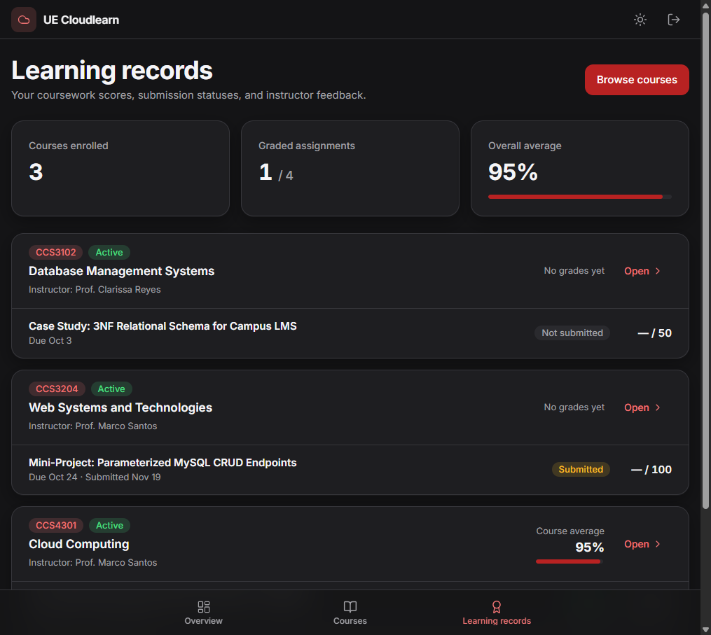

*Figure 2.8: Dark Theme Adaptive Interface (`/records`).*

---

## 2.5 Use Case Diagram

UE Cloudlearn supports 14 distinct functional use cases distributed across the Student, Instructor, and Administrator actors, with shared authentication spanning all roles. Figure 2.9 models actor-to-use-case associations and permission inheritance.

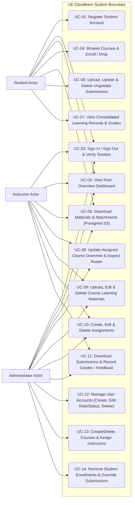

*Figure 2.9: UE Cloudlearn System Use Case Diagram Across Student, Instructor, and Administrator Actors.*

---

## 2.6 Data Flow Diagram

To analyze how academic inputs transform into relational rows and secure cloud objects, data flows are modeled at both the Context Level (Level 0) and Process Decomposition Level (Level 1).

### 2.6.1 Context-Level Data Flow Diagram (Level 0)

At Level 0 (Figure 2.10), UE Cloudlearn acts as a single unified cloud process exchanging credentials, course updates, binary documents, presigned URLs, and grade summaries with the three external user entities.

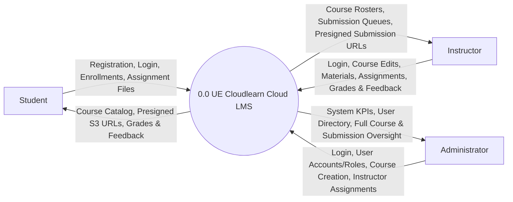

*Figure 2.10: Context-Level (Level 0) Data Flow Diagram of UE Cloudlearn.*

### 2.6.2 Level 1 Data Flow Diagram

Level 1 (Figure 2.11) decomposes the system into six core sub-processes (`P1` through `P6`) interacting directly with the two authoritative cloud data stores: **D1: Amazon RDS (`ue_cloudlearn`)** for relational metadata and **D2: Amazon S3 (`ue-cloudlearn-files-ccs4301-7dfd0a`)** for encrypted binary files.

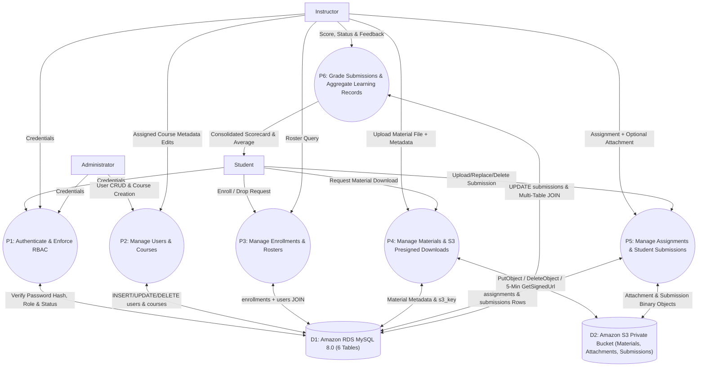

*Figure 2.11: Level 1 Data Flow Diagram Showing Core Processes (`P1`–`P6`) and Data Stores (`D1`: Amazon RDS MySQL, `D2`: Amazon S3 Bucket).*

---

## 2.7 Database Design

### 2.7.1 Normalization Strategy

The `ue_cloudlearn` schema follows strict **Third Normal Form (3NF)** design rules:

- **First Normal Form (1NF):** Every column holds atomic scalar values (e.g., `full_name`, `email`, `course_code`, `s3_key`, `score`); repeating groups of courses, materials, or submissions are decomposed into dedicated tables rather than comma-separated columns.
- **Second Normal Form (2NF):** Every non-key attribute depends on the entire primary key (`id`), while composite business uniqueness is enforced through `UNIQUE KEY uq_enrollment (student_id, course_id)` and `UNIQUE KEY uq_submission (assignment_id, student_id)`.
- **Third Normal Form (3NF):** Transitive dependencies are eliminated by storing instructor profiles solely in `users` (referenced by `courses.instructor_id`), course attributes solely in `courses`, and binary file objects in Amazon S3 (referenced solely via `s3_key` / `attachment_s3_key` metadata columns).

### 2.7.2 Entity-Relationship Diagram (ERD)

Figure 2.12 presents the complete Entity-Relationship Diagram derived directly from `database/schema.sql`.

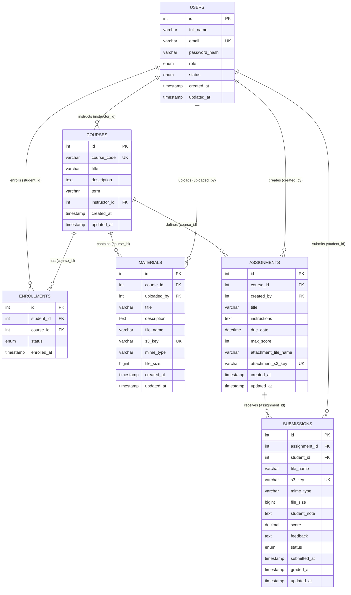

*Figure 2.12: Entity-Relationship Diagram (ERD) of the `ue_cloudlearn` MySQL 8.0 Database Schema.*

### 2.7.3 Complete Data Dictionary

Tables 2.6 through 2.11 specify every column, data type, nullability rule, default value, and constraint across all six InnoDB tables in `database/schema.sql`, followed by Table 2.12 summarizing all referential integrity rules.

**Table 2.6**  
*Data Dictionary for the `users` Table*

| Column | MySQL Data Type | Nullability | Default / Extra | Constraint / Purpose |
|---|---|---|---|---|
| `id` | `INT` | `NOT NULL` | `AUTO_INCREMENT` | `PRIMARY KEY` |
| `full_name` | `VARCHAR(120)` | `NOT NULL` | — | Full display name |
| `email` | `VARCHAR(190)` | `NOT NULL` | — | `UNIQUE KEY uq_users_email` (stored lowercase) |
| `password_hash` | `VARCHAR(255)` | `NOT NULL` | — | `bcryptjs` 10-round password digest |
| `role` | `ENUM('admin','instructor','student')` | `NOT NULL` | `'student'` | `INDEX idx_users_role` for RBAC filtering |
| `status` | `ENUM('active','inactive')` | `NOT NULL` | `'active'` | Soft-disable without breaking FKs |
| `created_at` | `TIMESTAMP` | `NOT NULL` | `CURRENT_TIMESTAMP` | Account creation timestamp |
| `updated_at` | `TIMESTAMP` | `NOT NULL` | `CURRENT_TIMESTAMP ON UPDATE` | Last modification timestamp |

**Table 2.7**  
*Data Dictionary for the `courses` Table*

| Column | MySQL Data Type | Nullability | Default / Extra | Constraint / Purpose |
|---|---|---|---|---|
| `id` | `INT` | `NOT NULL` | `AUTO_INCREMENT` | `PRIMARY KEY` |
| `course_code` | `VARCHAR(30)` | `NOT NULL` | — | `UNIQUE KEY uq_courses_code` (uppercase code, e.g., `CCS4301`) |
| `title` | `VARCHAR(160)` | `NOT NULL` | — | Official course title |
| `description` | `TEXT` | `NULL` | `NULL` | Syllabus overview |
| `term` | `VARCHAR(60)` | `NOT NULL` | `'First Semester 2026-2027'` | Academic semester identifier |
| `instructor_id` | `INT` | `NOT NULL` | — | `FK fk_courses_instructor -> users(id) ON DELETE RESTRICT`, `idx_courses_instructor` |
| `created_at` | `TIMESTAMP` | `NOT NULL` | `CURRENT_TIMESTAMP` | Record creation timestamp |
| `updated_at` | `TIMESTAMP` | `NOT NULL` | `CURRENT_TIMESTAMP ON UPDATE` | Last modification timestamp |

**Table 2.8**  
*Data Dictionary for the `enrollments` Table*

| Column | MySQL Data Type | Nullability | Default / Extra | Constraint / Purpose |
|---|---|---|---|---|
| `id` | `INT` | `NOT NULL` | `AUTO_INCREMENT` | `PRIMARY KEY` |
| `student_id` | `INT` | `NOT NULL` | — | `FK fk_enrollments_student -> users(id) ON DELETE CASCADE` |
| `course_id` | `INT` | `NOT NULL` | — | `FK fk_enrollments_course -> courses(id) ON DELETE CASCADE`, `idx_enrollments_course` |
| `status` | `ENUM('active','completed','dropped')` | `NOT NULL` | `'active'` | Enrollment lifecycle status |
| `enrolled_at` | `TIMESTAMP` | `NOT NULL` | `CURRENT_TIMESTAMP` | Enrollment timestamp; `UNIQUE KEY uq_enrollment (student_id, course_id)` |

**Table 2.9**  
*Data Dictionary for the `materials` Table*

| Column | MySQL Data Type | Nullability | Default / Extra | Constraint / Purpose |
|---|---|---|---|---|
| `id` | `INT` | `NOT NULL` | `AUTO_INCREMENT` | `PRIMARY KEY` |
| `course_id` | `INT` | `NOT NULL` | — | `FK fk_materials_course -> courses(id) ON DELETE CASCADE`, `idx_materials_course` |
| `uploaded_by` | `INT` | `NOT NULL` | — | `FK fk_materials_uploader -> users(id) ON DELETE RESTRICT` |
| `title` | `VARCHAR(180)` | `NOT NULL` | — | Material display title |
| `description` | `TEXT` | `NULL` | `NULL` | Short handout description |
| `file_name` | `VARCHAR(255)` | `NOT NULL` | — | Original client filename |
| `s3_key` | `VARCHAR(512)` | `NOT NULL` | — | `UNIQUE KEY uq_materials_s3_key` (`materials/course-{id}/{uuid}-{name}`) |
| `mime_type` | `VARCHAR(120)` | `NOT NULL` | — | Validated upload MIME type |
| `file_size` | `BIGINT UNSIGNED` | `NOT NULL` | — | Byte size (`<= 15 MB`) |
| `created_at` | `TIMESTAMP` | `NOT NULL` | `CURRENT_TIMESTAMP` | Upload timestamp |
| `updated_at` | `TIMESTAMP` | `NOT NULL` | `CURRENT_TIMESTAMP ON UPDATE` | Last modification timestamp |

**Table 2.10**  
*Data Dictionary for the `assignments` Table*

| Column | MySQL Data Type | Nullability | Default / Extra | Constraint / Purpose |
|---|---|---|---|---|
| `id` | `INT` | `NOT NULL` | `AUTO_INCREMENT` | `PRIMARY KEY` |
| `course_id` | `INT` | `NOT NULL` | — | `FK fk_assignments_course -> courses(id) ON DELETE CASCADE` |
| `created_by` | `INT` | `NOT NULL` | — | `FK fk_assignments_creator -> users(id) ON DELETE RESTRICT` |
| `title` | `VARCHAR(180)` | `NOT NULL` | — | Assignment headline |
| `instructions` | `TEXT` | `NOT NULL` | — | Detailed prompt / rubric |
| `due_date` | `DATETIME` | `NOT NULL` | — | Deadline indexed with `idx_assignments_course_due (course_id, due_date)` |
| `max_score` | `INT UNSIGNED` | `NOT NULL` | `100` | `CONSTRAINT chk_assignments_max_score CHECK (max_score > 0)` |
| `attachment_file_name` | `VARCHAR(255)` | `NULL` | `NULL` | Optional reference filename |
| `attachment_s3_key` | `VARCHAR(512)` | `NULL` | `NULL` | `UNIQUE KEY uq_assignments_attachment_s3_key` (`assignments/course-{id}/{uuid}-{name}`) |
| `created_at` | `TIMESTAMP` | `NOT NULL` | `CURRENT_TIMESTAMP` | Creation timestamp |
| `updated_at` | `TIMESTAMP` | `NOT NULL` | `CURRENT_TIMESTAMP ON UPDATE` | Last modification timestamp |

**Table 2.11**  
*Data Dictionary for the `submissions` Table*

| Column | MySQL Data Type | Nullability | Default / Extra | Constraint / Purpose |
|---|---|---|---|---|
| `id` | `INT` | `NOT NULL` | `AUTO_INCREMENT` | `PRIMARY KEY` |
| `assignment_id` | `INT` | `NOT NULL` | — | `FK fk_submissions_assignment -> assignments(id) ON DELETE CASCADE` |
| `student_id` | `INT` | `NOT NULL` | — | `FK fk_submissions_student -> users(id) ON DELETE CASCADE`, `idx_submissions_student` |
| `file_name` | `VARCHAR(255)` | `NOT NULL` | — | Submitted filename |
| `s3_key` | `VARCHAR(512)` | `NOT NULL` | — | `UNIQUE KEY uq_submissions_s3_key` (`submissions/assignment-{id}/student-{id}/{uuid}-{name}`) |
| `mime_type` | `VARCHAR(120)` | `NOT NULL` | — | Validated MIME type |
| `file_size` | `BIGINT UNSIGNED` | `NOT NULL` | — | Submitted file size in bytes |
| `student_note` | `TEXT` | `NULL` | `NULL` | Optional note submitted by student |
| `score` | `DECIMAL(6,2)` | `NULL` | `NULL` | `CONSTRAINT chk_submissions_score CHECK (score IS NULL OR score >= 0)` |
| `feedback` | `TEXT` | `NULL` | `NULL` | Instructor grading remarks |
| `status` | `ENUM('submitted','graded','returned')` | `NOT NULL` | `'submitted'` | Grading workflow state |
| `submitted_at` | `TIMESTAMP` | `NOT NULL` | `CURRENT_TIMESTAMP` | Submission timestamp; `UNIQUE KEY uq_submission (assignment_id, student_id)` |
| `graded_at` | `TIMESTAMP` | `NULL` | `NULL` | Populated via `NOW()` when graded |
| `updated_at` | `TIMESTAMP` | `NOT NULL` | `CURRENT_TIMESTAMP ON UPDATE` | Last modification timestamp |

**Table 2.12**  
*Summary of Primary Keys, Foreign Keys, Unique Keys, Check Constraints, and Referential Integrity Rules*

| Constraint Name | Table | Column(s) | Rule / Referenced Target | Engineering Rationale |
|---|---|---|---|---|
| `uq_users_email` | `users` | `email` | `UNIQUE` | Prevents duplicate user registrations |
| `uq_courses_code` | `courses` | `course_code` | `UNIQUE` | Guarantees distinct course codes (e.g., `CCS4301`) |
| `fk_courses_instructor` | `courses` | `instructor_id` | `users(id) ON DELETE RESTRICT ON UPDATE CASCADE` | Prevents accidental deletion of instructors owning active courses (`409 USER_IN_USE`) |
| `uq_enrollment` | `enrollments` | `(student_id, course_id)` | `UNIQUE` | Enforces at most one enrollment row per student/course pair |
| `fk_enrollments_student` | `enrollments` | `student_id` | `users(id) ON DELETE CASCADE` | Cleans up student enrollments if a student account is deleted |
| `fk_enrollments_course` | `enrollments` | `course_id` | `courses(id) ON DELETE CASCADE` | Removes enrollments automatically when a course is deleted |
| `fk_materials_course` | `materials` | `course_id` | `courses(id) ON DELETE CASCADE` | Removes course materials when parent course is deleted |
| `fk_materials_uploader` | `materials` | `uploaded_by` | `users(id) ON DELETE RESTRICT` | Preserves audit attribution for uploaded instructional files |
| `uq_materials_s3_key` | `materials` | `s3_key` | `UNIQUE` | Ensures 1-to-1 mapping between RDS metadata and S3 object key |
| `chk_assignments_max_score` | `assignments` | `max_score` | `CHECK (max_score > 0)` | Prevents division-by-zero in percentage score calculations |
| `fk_assignments_course` | `assignments` | `course_id` | `courses(id) ON DELETE CASCADE` | Cleans up assignments when a course is deleted |
| `fk_assignments_creator` | `assignments` | `created_by` | `users(id) ON DELETE RESTRICT` | Preserves creator integrity on course assignments |
| `uq_assignments_attachment_s3_key` | `assignments` | `attachment_s3_key` | `UNIQUE` | Guarantees unique S3 key for optional reference attachments |
| `uq_submission` | `submissions` | `(assignment_id, student_id)` | `UNIQUE` | Limits each student to one active submission per assignment (supports replacement) |
| `uq_submissions_s3_key` | `submissions` | `s3_key` | `UNIQUE` | Guarantees unique S3 object key per submission file |
| `chk_submissions_score` | `submissions` | `score` | `CHECK (score IS NULL OR score >= 0)` | Disallows negative scores at the database engine level |
| `fk_submissions_assignment` | `submissions` | `assignment_id` | `assignments(id) ON DELETE CASCADE` | Cascades deletion of assignment submissions |
| `fk_submissions_student` | `submissions` | `student_id` | `users(id) ON DELETE CASCADE` | Cleans up student submissions if account is removed |
