# CHAPTER 3: SYSTEM DEVELOPMENT AND IMPLEMENTATION

## 3.1 Development Environment

UE Cloudlearn was developed in a modular monorepo layout (`database/`, `backend/`, `frontend/`, `infra/`, `docs/`, `team-docs/`) using strict separation between version-controlled source code and runtime secrets. Table 3.1 summarizes the exact verified local engineering toolchain alongside the AWS production runtime environment configured on Ubuntu 24.04 LTS EC2.

**Table 3.1**  
*Local Development and Production Runtime Environment Versions*

| Tool / Component | Local Development Environment | Production AWS EC2 Environment (`ap-southeast-1`) |
|---|---|---|
| **Operating System** | Windows 11 Workstation | Ubuntu Server 24.04 LTS (`ami-071c84f5b32b09602`) |
| **Node.js & npm** | `node v24.19.0`, `npm 11.17.0` | `Node v20.20.2`, `npm 10.8.2` |
| **Version Control** | `git 2.55` (`core.autocrlf=false` for tar archives) | `git` + `/var/www/ue-cloudlearn` |
| **Web / Reverse Proxy** | Vite Dev Server (`localhost:5173`, `/api` proxy -> `:5000`) | `nginx/1.24.0` (`ue-cloudlearn.conf`, static `/` + proxy `/api/`) |
| **Process Runtime** | `node --watch src/server.js` | `PM2 7.1.2` (`ue-cloudlearn-api` + `pm2-ubuntu.service`) |
| **Database Engine** | Static SQL & `vitest` `mockDb` (`mysql2/promise`) | Amazon RDS MySQL `8.0.46` (`ue-cloudlearn-db`, `mysql Ver 8.0.46`) |
| **AWS CLI / Auth** | `aws-cli 2.40.2` (`~/.aws/credentials`, `ap-southeast-1`) | EC2 IAM Instance Profile (`ue-cloudlearn-ec2-role` via IMDSv2) |

Runtime environment configuration follows the root `.env.example` configuration contract. On EC2, `/var/www/ue-cloudlearn/.env` is locked with `chmod 600` permissions and loaded cleanly by `backend/src/config/env.js`, which searches candidate `.env` paths without overwriting process environment variables and validates `JWT_SECRET` (minimum 16 characters), database connection properties (`DB_HOST`, `DB_PORT`, `DB_NAME`, `DB_USER`, `DB_PASSWORD`), and `S3_BUCKET_NAME` when `STORAGE_MODE=s3`.

---

## 3.2 Frontend Development

The frontend client (`frontend/`) is a **React 18.3.1** + **TypeScript 5.6.3** single-page application bundled with **Vite 5.4.11** and styled using **Tailwind CSS 3.4.15** bound to CSS custom properties in `frontend/src/styles/tokens.css`. Rather than hardcoding color literals inside TSX components, `frontend/tailwind.config.js` maps semantic utility classes (`bg-canvas`, `bg-surface`, `bg-subtle`, `text-primary`, `text-secondary`, `bg-accent-fill`, `text-accent`, `border-hairline`) directly to the `:root` / `[data-theme="dark"]` design tokens.

Every backend call passes through a centralized typed wrapper (`frontend/src/lib/api.ts`), which automatically attaches `credentials: 'include'` so browser requests transmit the `ue_cloudlearn_token` `HttpOnly` cookie seamlessly over both local Vite proxying (`frontend/vite.config.ts`) and production Nginx same-origin routing. Helper utilities in `frontend/src/lib/formatters.ts` validate file extensions and the 15 MB ceiling (`validateUploadFile`) before sending `FormData`, convert local datetime fields to UTC ISO strings (`fromDatetimeLocalToIso`), and handle presigned S3 downloads (`openPresignedDownload`).

**Table 3.2**  
*Frontend Application Directory and Component Architecture (`frontend/src/`)*

| File Path | Architectural Purpose | Key Exports / Responsibilities |
|---|---|---|
| `frontend/src/main.tsx` | Application mount point | Renders root `<App />` into `#root` and imports `tokens.css` |
| `frontend/src/App.tsx` | Client router & providers | Wraps `ThemeProvider`, `ToastProvider`, `AuthProvider`, `BrowserRouter`, and role-guarded `<Route>` definitions |
| `frontend/src/styles/tokens.css` | Design system tokens | Light/dark UE Crimson tokens, `.apple-transition`, `.apple-focus-ring`, `.apple-backdrop-bar`, `prefers-reduced-motion` |
| `frontend/src/types/api.ts` | Shared TypeScript contracts | Typed interfaces for `User`, `Course`, `CourseMaterial`, `Assignment`, `Submission`, `StudentLearningRecords`, and `DashboardSummary` |
| `frontend/src/lib/api.ts` | Centralized fetch client | `api.get/post/patch/delete` with `credentials: 'include'` and structured `ApiError` parsing |
| `frontend/src/lib/formatters.ts` | Formatting & upload helpers | `getDisplayFirstName`, `formatDateTime`, `formatFileSize`, `validateUploadFile` (15 MB), `openPresignedDownload` |
| `frontend/src/context/AuthContext.tsx` | Session state provider | Hydrates session via `GET /api/auth/me` and provides `login`, `register`, `logout`, `refreshUser` |
| `frontend/src/context/ThemeContext.tsx` | Theme persistence provider | Syncs `[data-theme]` attribute and `localStorage` (`ue_cloudlearn_theme`) with OS dark mode preference |
| `frontend/src/components/layout/AppShell.tsx` | Responsive navigation shell | `248px` desktop left sidebar, mobile sticky header, frosted bottom tab bar (`48px` tabs), max-3 role nav items |
| `frontend/src/components/layout/ProtectedRoute.tsx` | Client route guard | Displays loading skeletons, redirects unauthenticated users to `/login`, enforces `allowedRoles` |
| `frontend/src/components/ui/*` | 13 reusable UI primitives | `Badge`, `Button`, `Card`, `ConfirmSheet`, `EmptyState`, `ErrorBanner`, `FilePicker`, `Input`, `ModalSheet`, `SegmentedControl`, `Select`, `Skeleton`, `Textarea`, `ToastProvider` |
| `frontend/src/pages/LoginPage.tsx` | Screen A (`/login`) | Email/password sign-in form with show/hide toggle and inline validation |
| `frontend/src/pages/RegisterPage.tsx` | Screen A2 (`/register`) | Student registration form (`fullName`, `email`, `password`, `confirmPassword`) |
| `frontend/src/pages/DashboardPage.tsx` | Screen B (`/`) | Role-specific overview greeting, 3 KPI cards, UE Crimson progress bar, and up to 5 recent rows |
| `frontend/src/pages/CoursesPage.tsx` | Screen C (`/courses`) | Searchable course catalog, role-scoped filter, student enroll/drop, admin create/edit/delete sheets |
| `frontend/src/pages/CourseDetailPage.tsx` | Screen D (`/courses/:id`) | Segmented tabs (`Materials`, `Assignments`, `Students`) with S3 uploads, presigned downloads, student submissions, and destructive confirmation sheets |
| `frontend/src/pages/SubmissionsPage.tsx` | Screen E (`/submissions`, `/courses/:id/assignments/:assignmentId`) | Staff submission inbox filtered by status/course, presigned downloads, and `Review submission` grading modal (`0..maxScore`) |
| `frontend/src/pages/RecordsPage.tsx` | Screen F (`/records`) | Student consolidated learning records strip, per-course averages, UE Crimson progress tracks, and inline feedback |
| `frontend/src/pages/UsersPage.tsx` | Screen G (`/users`) | Admin user directory with role filter, live search, create/edit user sheets, and self-protection guards |

---

## 3.3 Backend Development

The backend REST API (`backend/src/`) is implemented in **Node.js ES Modules** using **Express.js 4.21.2** without TypeScript compilation overhead on Free Tier hardware. `backend/src/server.js` initializes the `mysql2/promise` connection pool (`createDbPool()`), initializes the AWS SDK v3 S3 storage wrapper (`createS3Storage()`), constructs the Express application via `createApp({ db, storage })`, binds to `env.port` (`5000`), and wires `SIGINT`/`SIGTERM` handlers for graceful database pool shutdown. Separating `createApp()` in `backend/src/app.js` from `server.js` enables clean Supertest injection of mock database and S3 storage doubles during automated testing.

Global middleware in `backend/src/app.js` applies security headers (`helmet()`), credentialed CORS (`cors({ origin: env.corsOrigin, credentials: true })`), JSON body parsing (`1mb` cap), cookie parsing (`cookieParser()`), request logging (`morgan('dev')` outside test mode), 404 handling (`notFoundHandler`), and centralized error formatting (`errorHandler`) that sanitizes `AppError`, `multer.MulterError` (`LIMIT_FILE_SIZE -> 400 FILE_TOO_LARGE`), `ZodError` (`400 VALIDATION_ERROR`), and `SyntaxError` (`400 INVALID_JSON`) responses so raw SQL or stack traces are never returned to clients. Table 3.3 catalogs every backend source file, and Table 3.4 specifies all **35** REST API endpoints verified across the 9 route files.

**Table 3.3**  
*Backend Application Directory and Service Architecture (`backend/src/`)*

| Directory / File | Architectural Layer | Key Responsibilities |
|---|---|---|
| `backend/src/server.js` | Entry Point | Connects MySQL pool + S3 storage, starts HTTP listener on port `5000`, handles `SIGINT`/`SIGTERM` |
| `backend/src/app.js` | Application Factory | Configures `helmet`, `cors`, `express.json`, `cookieParser`, mounts 9 route modules, attaches error handlers |
| `backend/src/config/env.js` | Configuration | Loads `.env`, parses integer ports/flags, validates `JWT_SECRET`, RDS, and S3 variables (`validateEnv`) |
| `backend/src/config/db.js` | Persistence Config | Creates `mysql2/promise` pool (`connectionLimit: 10`, `charset: 'utf8mb4'`, `decimalNumbers: true`) |
| `backend/src/config/s3.js` | Object Storage Config | Sanitizes filenames, constructs UUID S3 keys (`buildMaterialKey`, `buildAssignmentKey`, `buildSubmissionKey`), sends `PutObjectCommand`/`DeleteObjectCommand`, generates 300s presigned GET URLs (`createS3Storage`) |
| `backend/src/middleware/auth.js` | Security Middleware | `requireAuth` (reads `ue_cloudlearn_token` cookie or Bearer header, verifies JWT + active RDS row) and `requireRole(...roles)` |
| `backend/src/middleware/upload.js` | File Validation | `multer.memoryStorage()` enforcing `MAX_UPLOAD_SIZE_BYTES = 15 MB` and strict extension/MIME allowlist (`.pdf`, `.docx`, `.pptx`, `.xlsx`, `.txt`, `.png`, `.jpg`, `.jpeg`, `.zip`) |
| `backend/src/middleware/validate.js` | Input Validation | `validate({ params, query, body })` middleware wrapping Zod schemas |
| `backend/src/middleware/errorHandler.js` | Error Handling | Maps `AppError`, `MulterError`, `ZodError`, and unhandled faults to standard JSON envelopes |
| `backend/src/routes/*.routes.js` | Route Modules (9 files) | Defines all 35 REST routes with Zod parameter/query/body schemas and RBAC middleware chains |
| `backend/src/controllers/*.controller.js` | Request Controllers (8 files) | Orchestrates authorization, S3 upload/rollback on DB error, presigned URL generation, and JSON responses |
| `backend/src/services/*.service.js` | SQL Services (7 files) | Executes explicit `?`-parameterized `mysql2/promise` queries (`user`, `course`, `enrollment`, `material`, `assignment`, `submission`, `records`) |
| `backend/src/utils/response.js`, `date.js` | Utilities | `AppError`, `sendSuccess`, `mapUserRow`, `toMysqlDateTime` |
| `backend/src/scripts/seed-passwords.js` | Operational CLI | Hashes `SEED_DEMO_PASSWORD` via `bcryptjs` (10 rounds) to activate seeded `@ue-cloudlearn.edu.ph` demo accounts |

**Table 3.4**  
*Complete REST API Endpoint Contract and Role Authorization Matrix (35 Endpoints)*

| # | Domain | Method & Path | Allowed Roles | Implemented Controller / Purpose |
|---|---|---|---|---|
| 1 | Health | `GET /api/health` | Public | Executes `SELECT 1 AS ok`; returns `{ status: "ok", db: "connected" }` |
| 2 | Auth | `POST /api/auth/register` | Public | Registers new `student` account (`bcryptjs`), sets `ue_cloudlearn_token` cookie (`201`) |
| 3 | Auth | `POST /api/auth/login` | Public | Verifies `bcryptjs` hash & `active` status, issues JWT cookie (`200`) |
| 4 | Auth | `POST /api/auth/logout` | Authenticated | Clears `ue_cloudlearn_token` cookie (`200`) |
| 5 | Auth | `GET /api/auth/me` | Authenticated | Returns active authenticated user profile (`200`) |
| 6 | Users | `GET /api/users` | `admin` | Lists users with optional `?role=` filter |
| 7 | Users | `POST /api/users` | `admin` | Creates user with explicit `admin`, `instructor`, or `student` role (`201`) |
| 8 | Users | `PATCH /api/users/:id` | `admin` | Updates `fullName`, `role`, or `status` (blocks self-demotion/deactivation) |
| 9 | Users | `DELETE /api/users/:id` | `admin` | Deletes user (blocks self-deletion; returns `409 USER_IN_USE` if referenced by `RESTRICT` FK) |
| 10 | Courses | `GET /api/courses` | Authenticated | Lists courses with `?search=` and `?scope=all\|enrolled\|assigned`, instructor name, and enrollment counts |
| 11 | Courses | `GET /api/courses/:id` | Authenticated | Returns course detail including material and assignment counts |
| 12 | Courses | `POST /api/courses` | `admin` | Creates course and validates assigned active `instructor` (`201`) |
| 13 | Courses | `PATCH /api/courses/:id` | `admin`, assigned `instructor` | Updates course fields (only `admin` can modify `courseCode` or `instructorId`) |
| 14 | Courses | `DELETE /api/courses/:id` | `admin` | Collects dependent S3 keys, deletes RDS course (`CASCADE`), and purges S3 objects |
| 15 | Enrollments | `POST /api/courses/:courseId/enroll` | `student` | Enrolls student or reactivates dropped enrollment (`201`) |
| 16 | Enrollments | `DELETE /api/courses/:courseId/enroll` | `student`, `admin` | Drops student enrollment (admin specifies `?studentId=`) |
| 17 | Enrollments | `GET /api/courses/:courseId/students` | `admin`, assigned `instructor` | Returns sorted enrolled student roster |
| 18 | Materials | `GET /api/courses/:courseId/materials` | Enrolled `student`, assigned `instructor`, `admin` | Lists learning materials metadata for the course |
| 19 | Materials | `POST /api/courses/:courseId/materials` | Assigned `instructor`, `admin` | Validates course write access + file, uploads to S3, inserts RDS row (`201`, rolls back S3 on DB error) |
| 20 | Materials | `PATCH /api/materials/:id` | Assigned `instructor`, `admin` | Updates title/description and optionally replaces S3 file (deletes old S3 object) |
| 21 | Materials | `DELETE /api/materials/:id` | Assigned `instructor`, `admin` | Deletes RDS material row and deletes corresponding S3 object |
| 22 | Materials | `GET /api/materials/:id/download` | Enrolled `student`, assigned `instructor`, `admin` | Issues 300-second S3 presigned GET URL with `Content-Disposition: attachment` |
| 23 | Assignments | `GET /api/courses/:courseId/assignments` | Enrolled `student`, assigned `instructor`, `admin` | Lists assignments (joined with student's `mySubmission` or staff `submissionCount`/`gradedCount`) |
| 24 | Assignments | `POST /api/courses/:courseId/assignments` | Assigned `instructor`, `admin` | Creates assignment with optional S3 reference attachment (`201`) |
| 25 | Assignments | `PATCH /api/assignments/:id` | Assigned `instructor`, `admin` | Updates assignment details and optionally replaces S3 attachment |
| 26 | Assignments | `DELETE /api/assignments/:id` | Assigned `instructor`, `admin` | Deletes assignment (`CASCADE` submissions) and purges attachment + submission S3 objects |
| 27 | Assignments | `GET /api/assignments/:id/attachment` | Enrolled `student`, assigned `instructor`, `admin` | Issues 300-second S3 presigned GET URL for assignment attachment |
| 28 | Submissions | `GET /api/assignments/:assignmentId/submissions` | Assigned `instructor`, `admin` | Lists all student submissions for one assignment |
| 29 | Submissions | `POST /api/assignments/:assignmentId/submissions` | Enrolled `student` | Verifies active enrollment + ungraded guard (`409`), uploads to S3, inserts/updates submission row (`201`/`200`) |
| 30 | Submissions | `GET /api/submissions` | Assigned `instructor`, `admin` | Lists staff submissions inbox filterable by `?status=` and `?courseId=` |
| 31 | Submissions | `DELETE /api/submissions/:id` | Owner `student` (ungraded), `admin` | Deletes submission from RDS and S3 (`409 ALREADY_GRADED` if student submission already graded) |
| 32 | Submissions | `GET /api/submissions/:id/download` | Owner `student`, assigned `instructor`, `admin` | Issues 300-second S3 presigned GET URL for submitted file |
| 33 | Submissions | `PATCH /api/submissions/:id/grade` | Assigned `instructor`, `admin` | Validates `0 <= score <= maxScore`, saves score/feedback/status, sets `graded_at = NOW()` |
| 34 | Records | `GET /api/records/me` | `student` | Executes 4-table SQL `JOIN` returning per-course and overall academic averages |
| 35 | Dashboard | `GET /api/dashboard/summary` | Authenticated | Executes role-specific summary queries (3 KPIs + recent lists) |

---

## 3.4 System Functionalities

Every user-facing workflow implemented in `frontend/src/pages/` was verified live on the deployed Amazon EC2 + RDS + S3 environment at `http://47.131.249.155`. Figures 3.1 through 3.11 present actual system screenshots captured across Administrator, Instructor, and Student sessions.

### 3.4.1 Administrator Functionalities

Administrators enter an executive overview displaying total users, total courses, active enrollments, recent courses, and recently registered users (Figure 3.1). From `/courses`, administrators create courses, assign or reassign active instructors, edit course descriptions, and delete obsolete courses (Figure 3.2). From `/users`, administrators filter accounts by role (`All`, `Students`, `Instructors`, `Admins`), create users across any role, and modify status (`Active` / `Inactive`) while self-modification protections prevent accidental admin lockout (Figure 3.3).

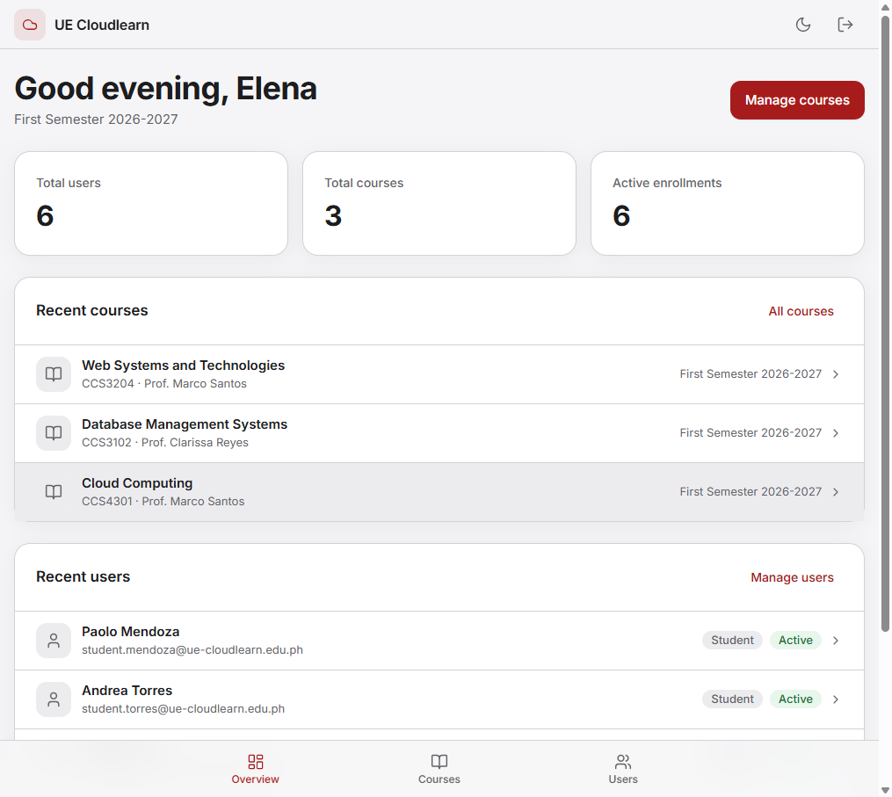

*Figure 3.1: Administrator Overview Dashboard and System KPIs.*

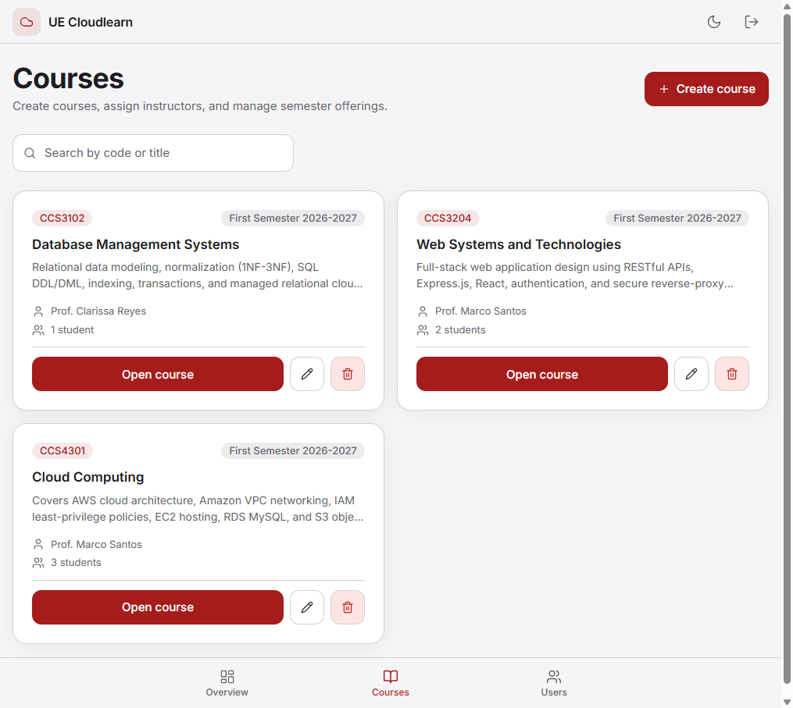

*Figure 3.2: Administrator Courses Directory and Instructor Assignment.*

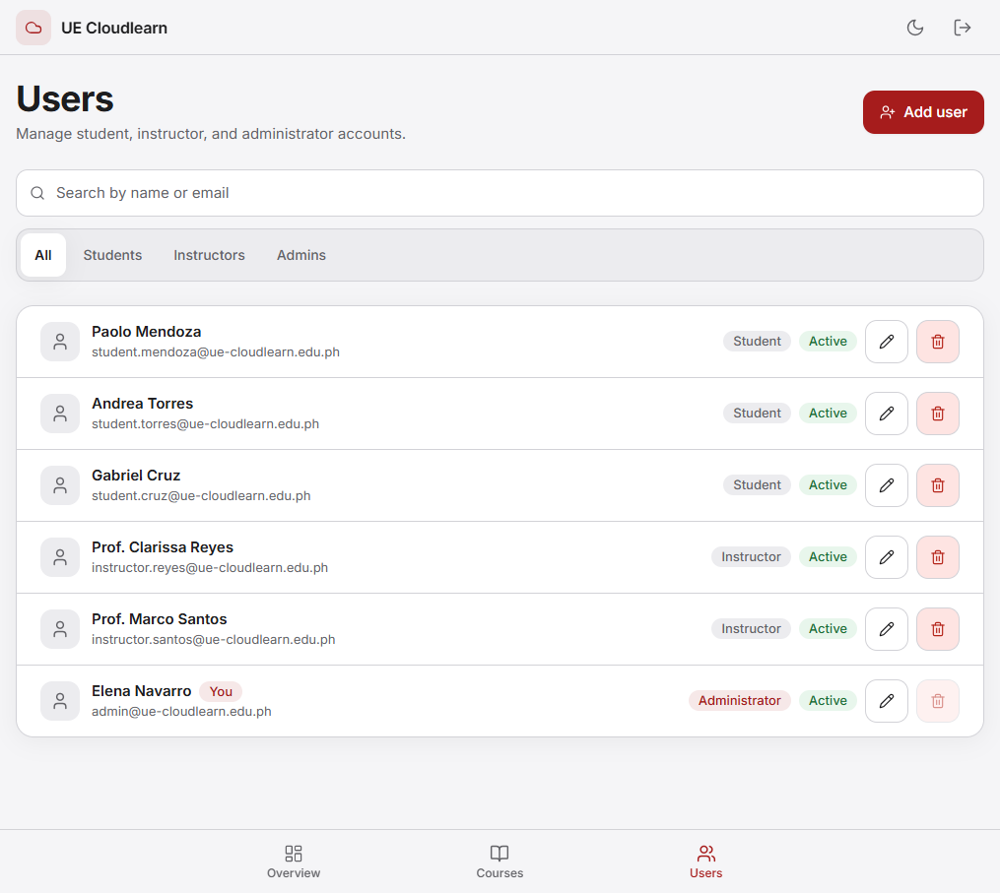

*Figure 3.3: Administrator User Accounts and Role Management.*

### 3.4.2 Instructor Functionalities

Instructors view assigned courses, pending grading counts, and recent submissions on their dashboard (Figure 3.4). Inside `/courses/:id`, segmented tabs separate **Materials** (supporting direct S3 uploads up to 15 MB, metadata edits, 5-minute presigned downloads, and coordinated S3 + RDS deletion, shown in Figure 3.5), **Assignments** (defining due dates, maximum scores, and optional S3 attachments, shown in Figure 3.6), and **Students** (displaying the active enrolled roster, shown in Figure 3.7). Instructors grade student submissions either from the course assignment page or the unified `/submissions` inbox (Figure 3.8) using the bounded `Review submission` modal sheet (Figure 3.9).

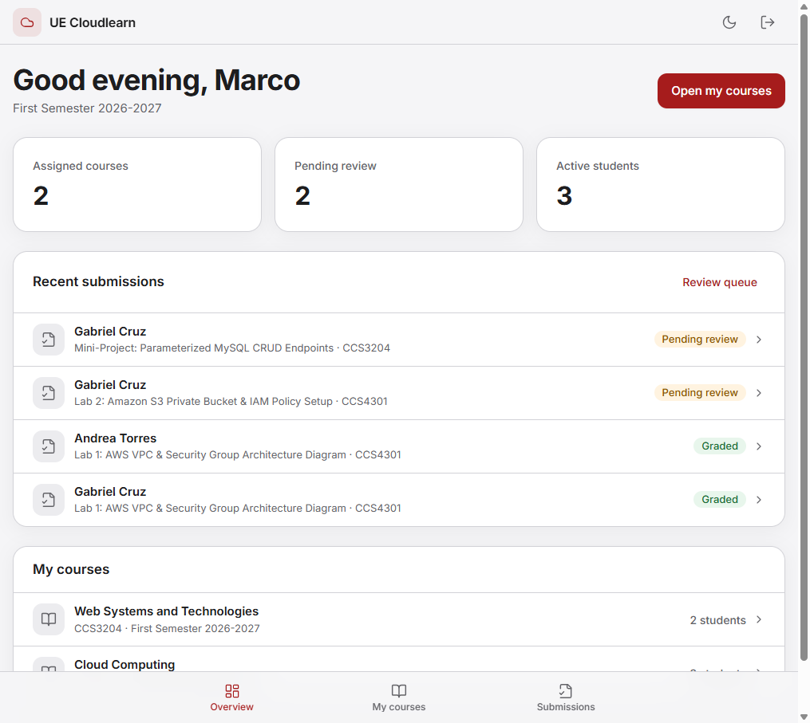

*Figure 3.4: Instructor Overview Dashboard.*

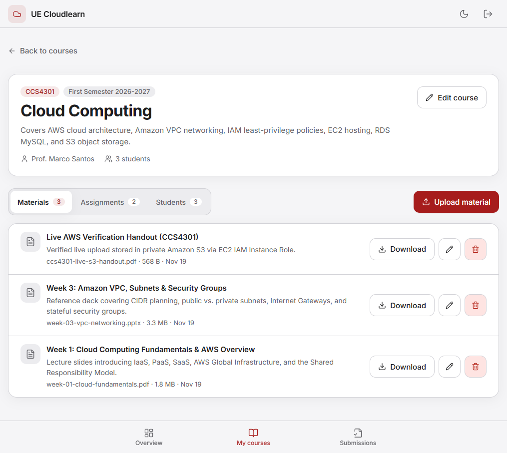

*Figure 3.5: Course Detail Workspace — Learning Materials Tab with Amazon S3 Upload and Presigned Download.*

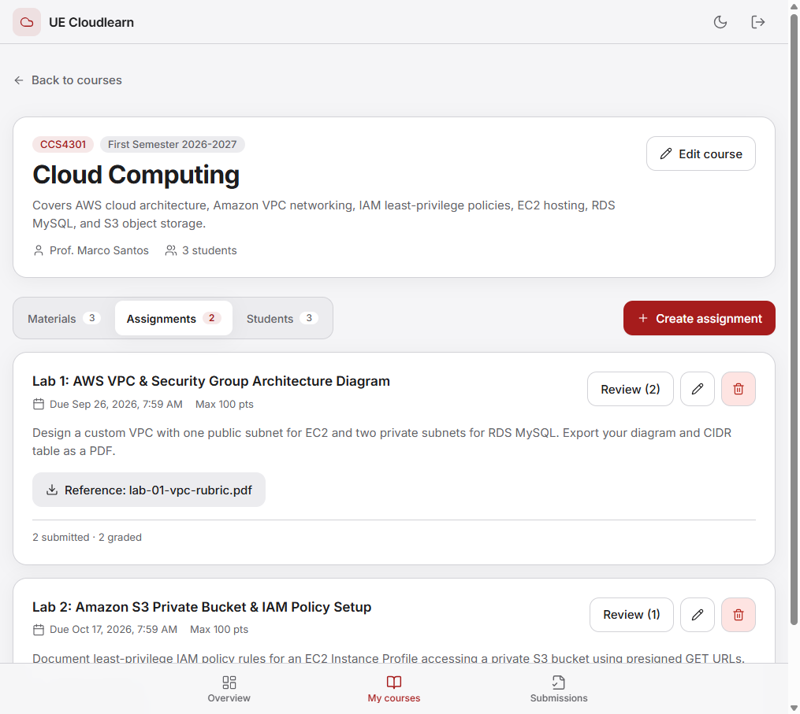

*Figure 3.6: Course Detail Workspace — Course Assignments Tab.*

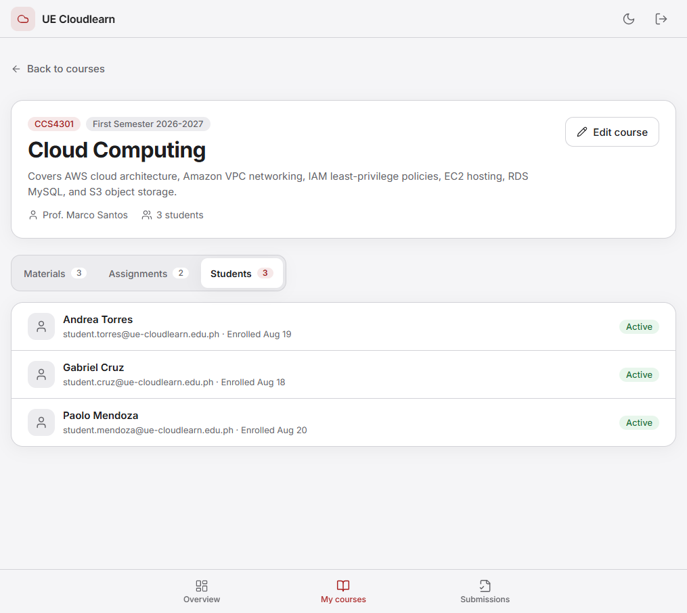

*Figure 3.7: Course Detail Workspace — Enrolled Students Roster Tab.*

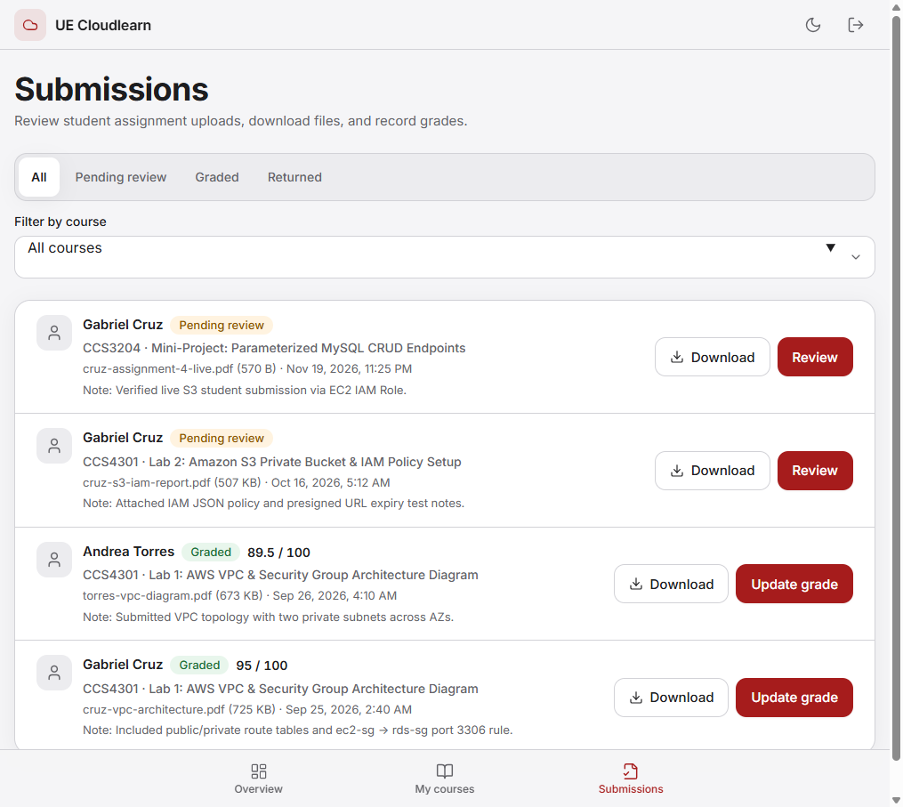

*Figure 3.8: Instructor Submissions Inbox and Review Queue.*

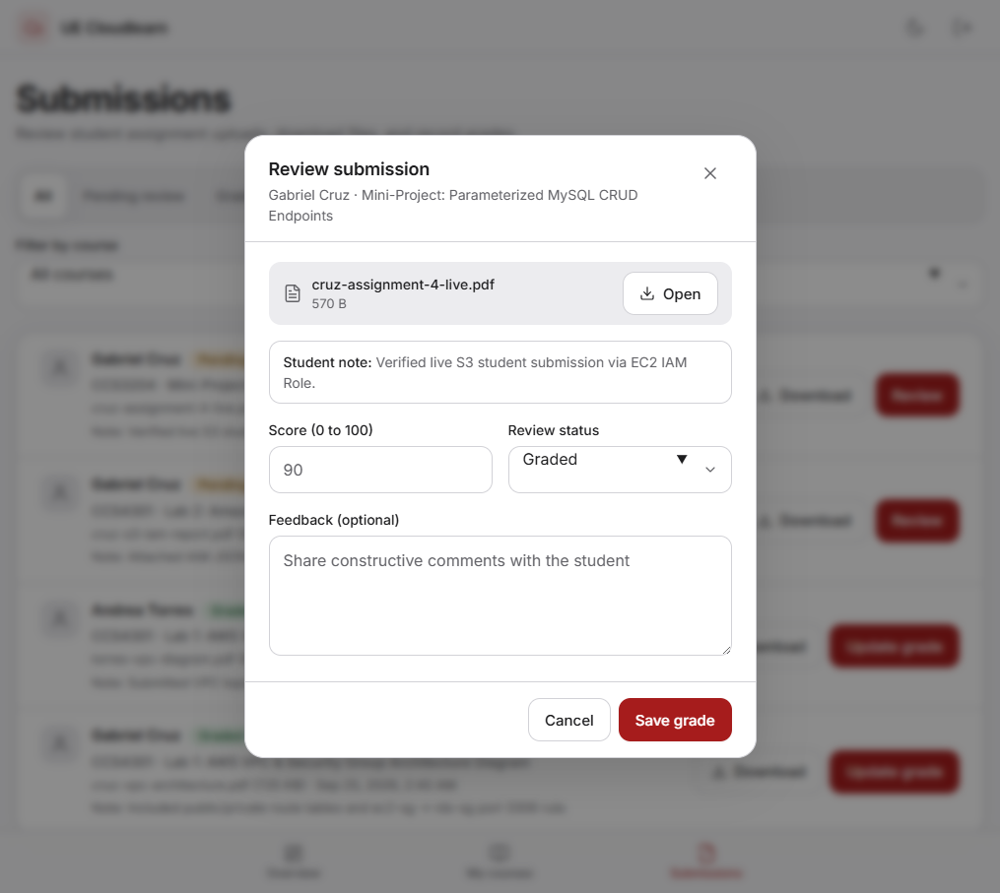

*Figure 3.9: Instructor Assignment Grading Modal Sheet.*

### 3.4.3 Student Functionalities

Students see enrolled course counts, pending assignments, their computed average percentage, upcoming deadlines, and recent grades upon logging in (Figure 3.10). Students browse and self-enroll from `/courses`, download handouts and rubrics via 5-minute presigned URLs, upload or replace ungraded assignment deliverables, and monitor their consolidated academic progress across all enrolled courses in `/records` (Figure 3.11), complete with UE Crimson course average bars and inline instructor feedback.

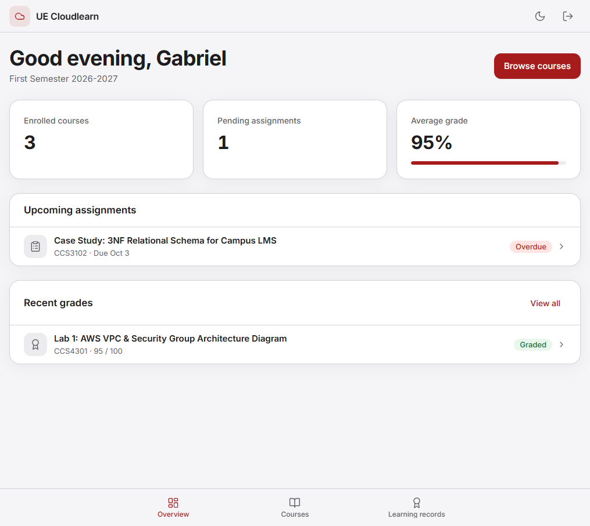

*Figure 3.10: Student Overview Dashboard with Upcoming Assignments and Recent Grades.*

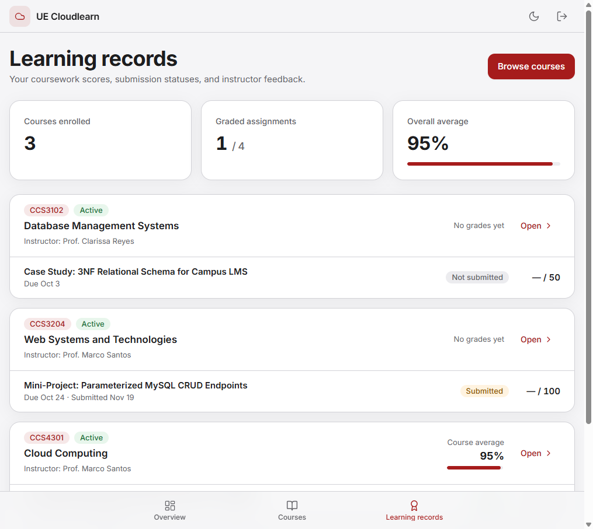

*Figure 3.11: Student Consolidated Learning Records Powered by Multi-Table SQL `JOIN`.*

---

## 3.5 User Authentication and Access Management

Authentication and Role-Based Access Control (RBAC) protect every non-public resource on the backend server rather than relying solely on React UI visibility:

1. **Password Hashing and Seed Hygiene:** During registration (`POST /api/auth/register`) or admin user creation (`POST /api/users`), plaintext passwords are never persisted; `bcryptjs` hashes passwords using `10` salt rounds (`bcrypt.hash(password, 10)`). Seeded accounts in `database/seed.sql` intentionally hold the explicit placeholder string `PENDING_BCRYPTJS_HASH_RUN_SEED_SCRIPT` under our environment-driven seed password policy, which `loginHandler` rejects (`401 INVALID_CREDENTIALS`) until an operator activates demo accounts at runtime via `backend/src/scripts/seed-passwords.js`.
2. **JWT Session Cookies and Configurable `COOKIE_SECURE`:** Upon authentication, `signAuthToken` signs `{ sub: user.id, role: user.role }` with `JWT_SECRET` for `24h` (`backend/src/controllers/auth.controller.js`). The token is stored in an `HttpOnly`, `SameSite=Lax` cookie named `ue_cloudlearn_token` (`maxAge: 86400000` ms). Under the configurable cookie security policy, the cookie `Secure` flag is controlled by `COOKIE_SECURE` (`false` for plain HTTP over the EC2 IPv4 endpoint during live class demonstrations; `true` whenever HTTPS/TLS is enabled). `extractToken` in `backend/src/middleware/auth.js` also honors `Authorization: Bearer <token>` headers for automated API testing.
3. **Database-Backed Session Verification & RBAC:** `requireAuth` validates the JWT signature and immediately queries `SELECT id, full_name, email, role, status, created_at FROM users WHERE id = ?` in Amazon RDS so deactivated (`status = 'inactive'`) or deleted accounts lose access immediately (`403 ACCOUNT_INACTIVE` / `401 UNAUTHORIZED`). Subsequent middleware (`requireRole(...allowedRoles)`) and course-ownership helpers (`requireCourseReadAccess`, `requireCourseWriteAccess` in `backend/src/services/course.service.js`) verify role and course enrollment or instructor assignment before executing business logic.

Figure 3.12 traces this end-to-end authentication and RBAC sequence, and Table 3.5 summarizes module-level permissions.

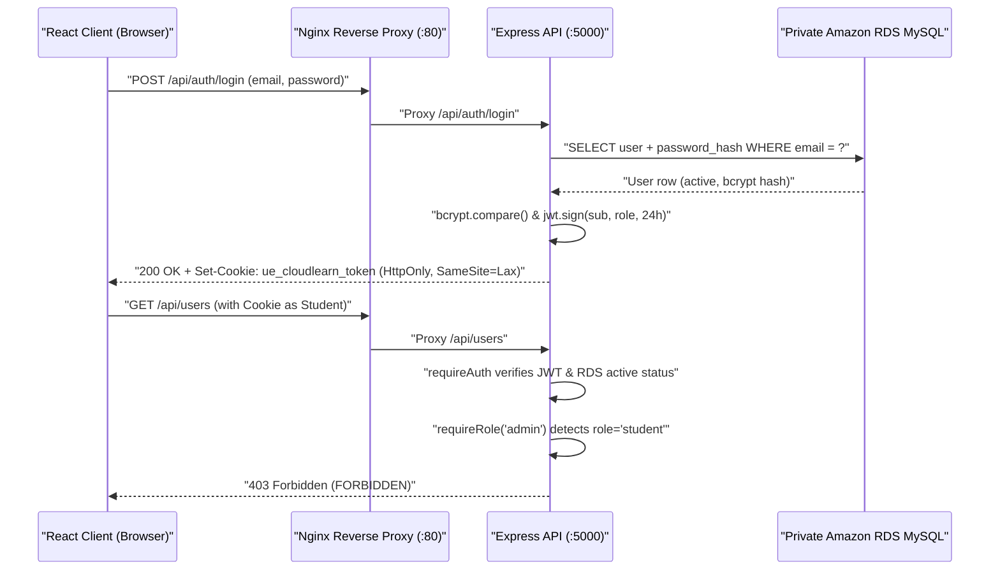

*Figure 3.12: JWT Cookie Authentication and Role-Based Access Control (RBAC) Sequence Diagram.*

**Table 3.5**  
*Role-Based Access Control (RBAC) Permission Matrix Across System Modules*

| System Operation | Unauthenticated | Student (`student`) | Instructor (`instructor`) | Administrator (`admin`) |
|---|---|---|---|---|
| `GET /api/health`, `POST /api/auth/login`, `POST /api/auth/register` | Allowed | Allowed | Allowed | Allowed |
| Manage Users (`GET/POST/PATCH/DELETE /api/users`) | `401` | `403 Forbidden` | `403 Forbidden` | Allowed (no self-delete) |
| Create / Delete Courses (`POST/DELETE /api/courses`) | `401` | `403 Forbidden` | `403 Forbidden` | Allowed |
| Edit Course Title, Description, Term (`PATCH /api/courses/:id`) | `401` | `403 Forbidden` | Assigned courses only | Allowed (incl. reassign) |
| Self-Enroll / Drop Course (`POST/DELETE /api/courses/:id/enroll`) | `401` | Allowed | `403 Forbidden` | `DELETE` with `?studentId=` |
| View Enrolled Roster (`GET /api/courses/:id/students`) | `401` | `403 Forbidden` | Assigned courses only | Allowed |
| Upload / Edit / Delete Materials & Assignments | `401` | `403 Forbidden` | Assigned courses only | Allowed |
| Download Materials & Attachments (`.../download`, `.../attachment`) | `401` | Enrolled courses only | Assigned courses only | Allowed |
| Submit / Replace / Delete Ungraded Submission | `401` | Enrolled own (pre-grade) | `403 Forbidden` | `DELETE` allowed |
| Download Submissions & Save Grades (`PATCH /api/submissions/:id/grade`) | `401` | Download own only (`403` grade) | Assigned courses only | Allowed |
| View Student Learning Records (`GET /api/records/me`) | `401` | Allowed (own records) | `403 Forbidden` | `403 Forbidden` |

---

## 3.6 GitHub Repository and Version Control

All project source code, SQL scripts, AWS infrastructure runbooks, documentation chapters, and member study packets are maintained in the team's Git repository at `https://github.com/rocumen/UE-Cloudlearn` on branch `main`. Strict repository hygiene is enforced by root `.gitignore`, which blocks `.env`, `.env.*` (with `!.env.example` exception), `*.pem`, `*.key`, `*.ppk`, `*.p12`, `credentials.json`, `aws-credentials*`, `.aws/`, `node_modules/`, `frontend/dist/`, logs, and SQL backup dumps from entering Git history. Table 3.6 documents the top-level repository layout.

**Table 3.6**  
*Repository Directory Structure and Module Ownership*

| Path | Contents | Primary Responsible Member(s) |
|---|---|---|
| `.gitignore`, `.env.example`, `README.md` | Git ignore guardrails, sanitized env template, setup documentation | Mark Bautista, Mark Costin |
| `database/` | `schema.sql`, `seed.sql`, `sample_queries.sql` | Mark Cyron Feratero |
| `backend/` | Express API (`src/`), `seed-passwords.js`, 8 Vitest + Supertest suites (`tests/`) | Zac Dacquel |
| `frontend/` | React + TypeScript + Vite + Tailwind SPA (`src/`), UE Crimson tokens | Isabel Lopez |
| `infra/` | IAM JSON policies (`iam/`), Nginx/PM2 configs, EC2 bash scripts, AWS Free Tier checklist | Mark Bautista, Ryan Palacios, Reynald Ocumen |
| `docs/` | Preliminary pages, Chapters 1–6, APA 7th references, Appendices A–F, `screenshots/` | All 7 Members (QA Lead: Reynald Ocumen) |
| `team-docs/` | Shared master study guide and 7 individualized presentation packets | All 7 Members |

Development progressed through structured, modular engineering commits verified by automated test suites, static TypeScript and UI accessibility checks, and live AWS cloud deployment checks before merging to `main`. Figures 3.13 and 3.14 show the live GitHub repository structure and commit history on the `main` branch at `https://github.com/rocumen/UE-Cloudlearn`.

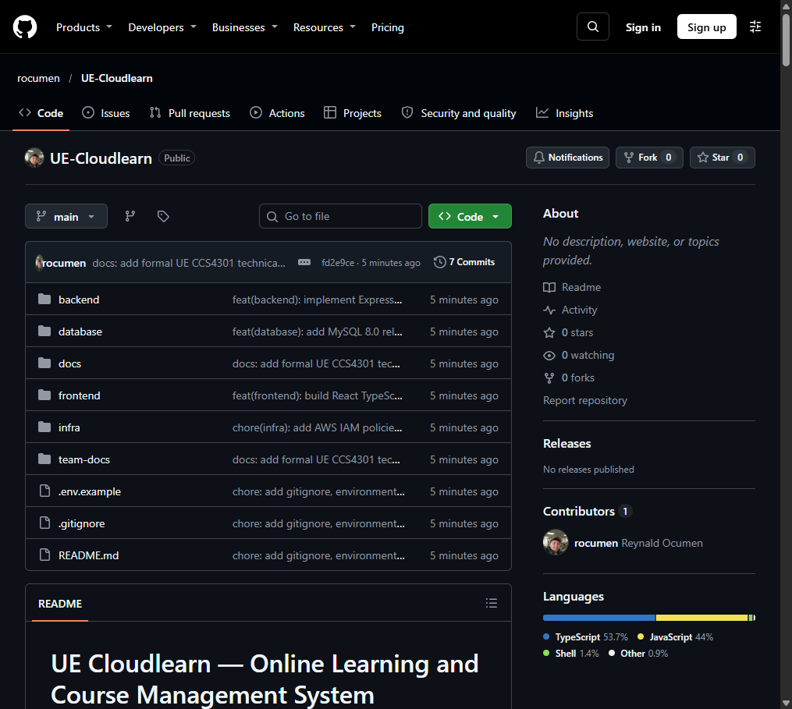

*Figure 3.13: GitHub Repository Structure Overview (`https://github.com/rocumen/UE-Cloudlearn`).*

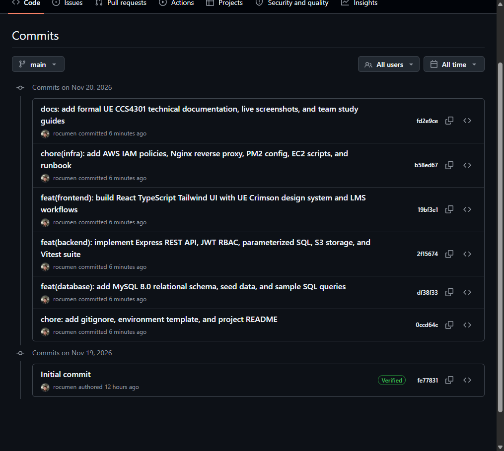

*Figure 3.14: GitHub Commit History and Milestone Verification Log.*
