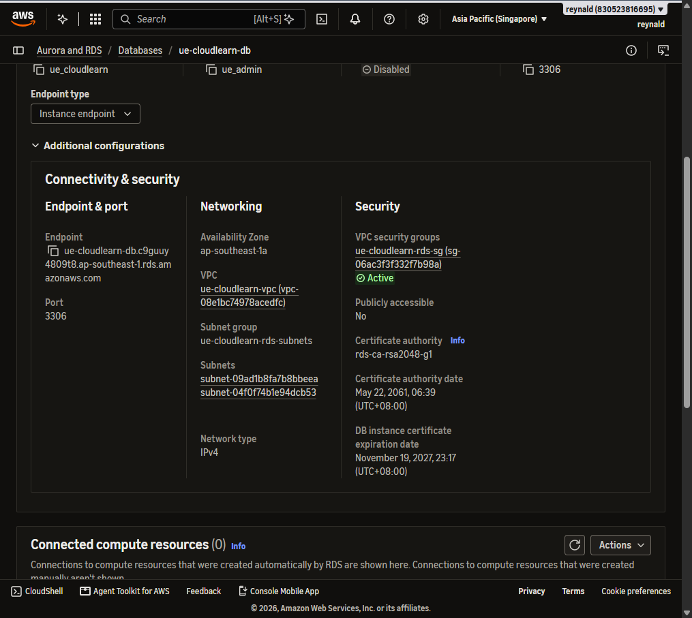
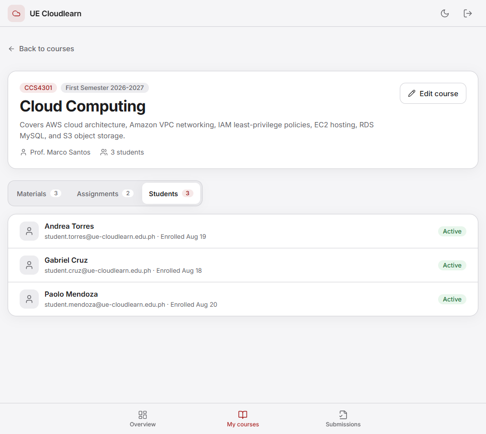
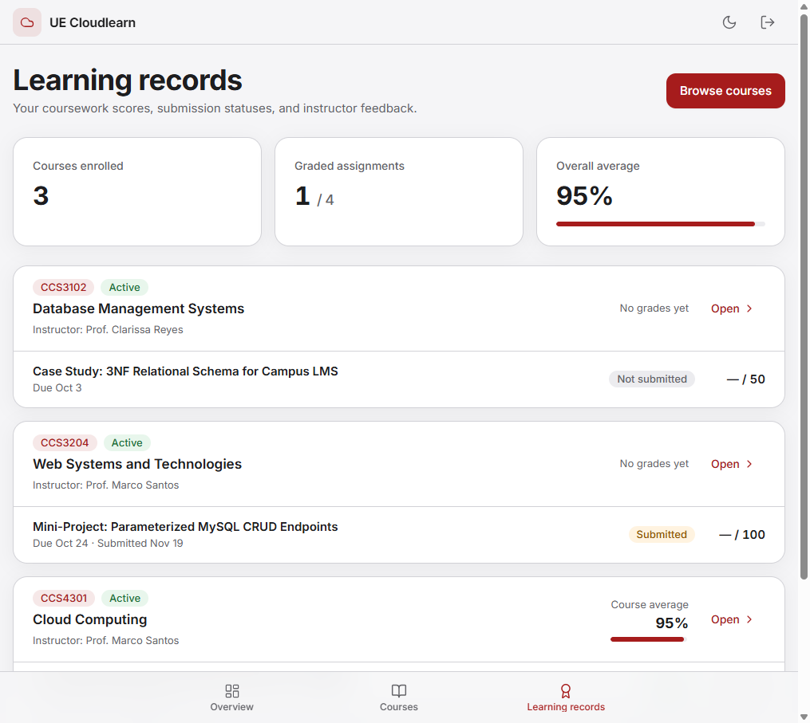

# CHAPTER 4: DATABASE IMPLEMENTATION (AMAZON RDS — MYSQL 8.0)

## 4.1 Database Environment

Structured application state in UE Cloudlearn is hosted on a managed **Amazon RDS for MySQL 8.0.46** database instance (`ue-cloudlearn-db`) provisioned inside private subnets of `ue-cloudlearn-vpc` in the `ap-southeast-1` (Singapore) region. Placing the database engine on Amazon RDS eliminates manual MySQL patching overhead while enforcing strict network isolation (`PubliclyAccessible = false`) and automated schema consistency (`InnoDB`, `utf8mb4_unicode_ci`). Table 4.1 documents the verified production RDS configuration parameters recorded in `infra/aws-architecture-checklist.md`.

**Table 4.1**  
*Amazon RDS for MySQL 8.0 Production Database Environment Parameters*

| Parameter | Verified Production Value | Engineering Purpose |
|---|---|---|
| **DB Instance Identifier** | `ue-cloudlearn-db` | Managed relational database identifier |
| **Database Engine & Version** | `MySQL 8.0.46` (`InnoDB`) | Transactional ACID storage with foreign-key and `CHECK` enforcement |
| **Instance Class & Storage** | `db.t3.micro`, `20 GB gp2`, Single-AZ | Strictly compliant with AWS Free Tier allowances |
| **Character Set & Collation** | `utf8mb4` / `utf8mb4_unicode_ci` | Full Unicode support for names, instructions, and feedback |
| **Database Name** | `ue_cloudlearn` | Primary application schema created by `database/schema.sql` |
| **Writer Endpoint & Port** | `ue-cloudlearn-db.c9guuy4809t8.ap-southeast-1.rds.amazonaws.com:3306` | Internal VPC DNS endpoint resolved exclusively inside `ue-cloudlearn-vpc` |
| **DB Subnet Group** | `ue-cloudlearn-rds-subnets` (`subnet-04f0f74b1e94dcb53`, `subnet-09ad1b8fa7b8bbeea`) | Spans two Availability Zones (`ap-southeast-1a` & `ap-southeast-1b`) |
| **Public Accessibility** | `false` (`PubliclyAccessible = No`) | Assigns zero public IPv4 address; unreachable from the public internet |
| **VPC Security Group** | `ue-cloudlearn-rds-sg` (`sg-06ac3f3f332f7b98a`) | Permits inbound TCP `3306` exclusively from `sg-0ffdde6854196014f` (`ec2-sg`) |

Figure 4.1 shows the running `ue-cloudlearn-db` instance inside the AWS RDS Management Console confirming its engine version, private subnet group, and security configuration.



*Figure 4.1: Amazon RDS for MySQL 8.0.46 Instance (`ue-cloudlearn-db`) Summary in AWS Console.*

---

## 4.2 Database Creation

The `ue_cloudlearn` schema is initialized via the idempotent DDL script `database/schema.sql`, which safely creates the database and all six tables in strict foreign-key dependency order (`users` -> `courses` -> `enrollments` -> `materials` -> `assignments` -> `submissions`). Because `ue-cloudlearn-db` denies external connections from outside the VPC, schema initialization and seed loading execute directly from the authorized EC2 application server (`i-0613bbaf4edddf9be`) using `mysql-client` (`Ver 8.0.46`) installed during `ec2-bootstrap.sh`:

```sql
CREATE DATABASE IF NOT EXISTS ue_cloudlearn
    CHARACTER SET utf8mb4
    COLLATE utf8mb4_unicode_ci;

USE ue_cloudlearn;
```

Production initialization on EC2 executed three sequential commands verified on the live instance:

```bash
mysql -h ue-cloudlearn-db.c9guuy4809t8.ap-southeast-1.rds.amazonaws.com -P 3306 -u ue_cloudlearn_app -p < /var/www/ue-cloudlearn/database/schema.sql
mysql -h ue-cloudlearn-db.c9guuy4809t8.ap-southeast-1.rds.amazonaws.com -P 3306 -u ue_cloudlearn_app -p ue_cloudlearn < /var/www/ue-cloudlearn/database/seed.sql
cd /var/www/ue-cloudlearn/backend && SEED_DEMO_PASSWORD="<runtime-password>" npm run seed:passwords
```

---

## 4.3 Database Tables and Structures

All six tables use `ENGINE=InnoDB` to enforce transactional foreign keys, cascade cleanup, and check constraints. Table 4.2 summarizes the relational structure, integrity rules, and indexing strategy defined in `database/schema.sql` (detailed column-by-column specifications appear in Chapter 2, Tables 2.6–2.12).

**Table 4.2**  
*Summary of the Six Normalized Tables in `ue_cloudlearn`*

| # | Table | Primary Key | Foreign Keys & Referential Actions | Unique Keys, Checks & Indexes |
|---|---|---|---|---|
| 1 | `users` | `id` | None (root identity entity) | `UNIQUE uq_users_email (email)`, `INDEX idx_users_role (role)` |
| 2 | `courses` | `id` | `instructor_id -> users(id) ON DELETE RESTRICT ON UPDATE CASCADE` | `UNIQUE uq_courses_code (course_code)`, `INDEX idx_courses_instructor` |
| 3 | `enrollments` | `id` | `student_id -> users(id) ON DELETE CASCADE`, `course_id -> courses(id) ON DELETE CASCADE` | `UNIQUE uq_enrollment (student_id, course_id)`, `INDEX idx_enrollments_course` |
| 4 | `materials` | `id` | `course_id -> courses(id) ON DELETE CASCADE`, `uploaded_by -> users(id) ON DELETE RESTRICT` | `UNIQUE uq_materials_s3_key (s3_key)`, `INDEX idx_materials_course` |
| 5 | `assignments` | `id` | `course_id -> courses(id) ON DELETE CASCADE`, `created_by -> users(id) ON DELETE RESTRICT` | `UNIQUE uq_assignments_attachment_s3_key`, `CHECK (max_score > 0)`, `INDEX idx_assignments_course_due` |
| 6 | `submissions` | `id` | `assignment_id -> assignments(id) ON DELETE CASCADE`, `student_id -> users(id) ON DELETE CASCADE` | `UNIQUE uq_submission (assignment_id, student_id)`, `UNIQUE uq_submissions_s3_key`, `CHECK (score IS NULL OR score >= 0)`, `INDEX idx_submissions_student` |

---

## 4.4 SQL Implementation (`CREATE`, `INSERT`, `SELECT`, `UPDATE`, `DELETE`, `JOIN`)

To guarantee full SQL auditability and prevent SQL injection, UE Cloudlearn deliberately avoids ORM frameworks and executes explicit `?`-parameterized `mysql2/promise` queries across `backend/src/services/*.js`, complemented by standalone SQL scripts in `database/schema.sql`, `database/seed.sql`, and `database/sample_queries.sql`.

### 4.4.1 `CREATE TABLE` Definition Excerpt (`database/schema.sql`)

```sql
CREATE TABLE IF NOT EXISTS submissions (
    id            INT             NOT NULL AUTO_INCREMENT,
    assignment_id INT             NOT NULL,
    student_id    INT             NOT NULL,
    file_name     VARCHAR(255)    NOT NULL,
    s3_key        VARCHAR(512)    NOT NULL,
    mime_type     VARCHAR(120)    NOT NULL,
    file_size     BIGINT UNSIGNED NOT NULL,
    student_note  TEXT            NULL,
    score         DECIMAL(6,2)    NULL,
    feedback      TEXT            NULL,
    status        ENUM('submitted', 'graded', 'returned') NOT NULL DEFAULT 'submitted',
    submitted_at  TIMESTAMP       NOT NULL DEFAULT CURRENT_TIMESTAMP,
    graded_at     TIMESTAMP       NULL,
    updated_at    TIMESTAMP       NOT NULL DEFAULT CURRENT_TIMESTAMP ON UPDATE CURRENT_TIMESTAMP,
    PRIMARY KEY (id),
    UNIQUE KEY uq_submission (assignment_id, student_id),
    UNIQUE KEY uq_submissions_s3_key (s3_key),
    INDEX idx_submissions_student (student_id),
    CONSTRAINT chk_submissions_score CHECK (score IS NULL OR score >= 0),
    CONSTRAINT fk_submissions_assignment
        FOREIGN KEY (assignment_id) REFERENCES assignments (id)
        ON DELETE CASCADE ON UPDATE CASCADE,
    CONSTRAINT fk_submissions_student
        FOREIGN KEY (student_id) REFERENCES users (id)
        ON DELETE CASCADE ON UPDATE CASCADE
) ENGINE=InnoDB DEFAULT CHARSET=utf8mb4 COLLATE=utf8mb4_unicode_ci;
```

### 4.4.2 `INSERT` Implementation (`database/seed.sql`, `sample_queries.sql` & `backend/src/services/`)

Initial realistic academic records are populated idempotently using `INSERT IGNORE INTO` across all six tables in `database/seed.sql` (6 users, 3 courses, 7 enrollments, 4 materials, 4 assignments, and 4 submissions). At runtime, backend services execute parameterized `INSERT` statements:

```javascript
// backend/src/services/material.service.js
const [result] = await db.execute(
  `INSERT INTO materials
     (course_id, uploaded_by, title, description, file_name, s3_key, mime_type, file_size)
   VALUES (?, ?, ?, ?, ?, ?, ?, ?)`,
  [courseId, uploadedBy, title, description, fileName, s3Key, mimeType, fileSize]
);
```

### 4.4.3 `SELECT` Implementation (`backend/src/services/course.service.js` & `user.service.js`)

Parameterized `SELECT` statements enforce filtering, escaping of `LIKE` wildcards (`%`, `_`), and explicit column projections so `password_hash` is never returned to client payloads:

```javascript
// backend/src/services/user.service.js
const [rows] = await db.execute(
  'SELECT id, full_name, email, role, status, created_at, updated_at FROM users WHERE role = ? ORDER BY created_at DESC, id DESC',
  [role]
);
```

### 4.4.4 `UPDATE` Implementation (`backend/src/services/submission.service.js`)

Dynamic updates build explicit whitelisted column clauses and bind all values through `?` placeholders:

```javascript
// backend/src/services/submission.service.js
await db.execute(
  'UPDATE submissions SET score = ?, feedback = ?, status = ?, graded_at = NOW() WHERE id = ?',
  [score, feedback, status, submissionId]
);
```

### 4.4.5 `DELETE` Implementation (`backend/src/services/enrollment.service.js` & `material.service.js`)

Targeted single-record `DELETE` statements pair with S3 object cleanup in controllers so database rows and S3 binary objects remain synchronized:

```javascript
// backend/src/services/material.service.js
const [result] = await db.execute('DELETE FROM materials WHERE id = ?', [
  materialId
]);
```

### 4.4.6 Multi-Table `JOIN` & Aggregate Implementation (`backend/src/services/records.service.js`)

Learning records and course catalog metrics combine relational data across three to four tables in single deterministic queries:

```sql
-- backend/src/services/records.service.js (also documented in database/sample_queries.sql Section 6b)
SELECT
    c.id AS course_id,
    c.course_code,
    c.title AS course_title,
    u.full_name AS instructor_name,
    e.status AS enrollment_status,
    a.id AS assignment_id,
    a.title AS assignment_title,
    a.due_date,
    a.max_score,
    s.id AS submission_id,
    s.status AS submission_status,
    s.score,
    s.feedback,
    s.submitted_at,
    s.graded_at
FROM enrollments AS e
INNER JOIN courses AS c ON c.id = e.course_id
INNER JOIN users AS u ON u.id = c.instructor_id
LEFT JOIN assignments AS a ON a.course_id = c.id
LEFT JOIN submissions AS s ON s.assignment_id = a.id AND s.student_id = e.student_id
WHERE e.student_id = ? AND e.status IN ('active', 'completed')
ORDER BY c.course_code ASC, a.due_date ASC, a.id ASC;
```

Table 4.3 summarizes all seven parameterized service modules implemented in `backend/src/services/`.

**Table 4.3**  
*Parameterized SQL Query Modules in `backend/src/services/`*

| Service Module | Primary Tables Queried | Verified SQL Operations |
|---|---|---|
| `user.service.js` | `users` | `SELECT`, `INSERT`, dynamic `UPDATE`, `DELETE` (`ER_ROW_IS_REFERENCED_2` guard), `seed-passwords` `UPDATE` |
| `course.service.js` | `courses`, `users`, `enrollments`, `materials`, `assignments`, `submissions` | Multi-table `JOIN` + `COUNT(DISTINCT ...)`, `INSERT`, `UPDATE`, `DELETE`, `collectCourseS3Keys` |
| `enrollment.service.js` | `enrollments`, `users`, `courses` | Duplicate enrollment guard, dropped reactivation `UPDATE`, `INSERT`, `DELETE`, roster `INNER JOIN` |
| `material.service.js` | `materials`, `users` | Course materials `INNER JOIN`, `INSERT`, dynamic `UPDATE`, `DELETE`, access check |
| `assignment.service.js` | `assignments`, `users`, `submissions` | Student `LEFT JOIN` submission status, staff aggregate `COUNT` grade summary, `INSERT`, `UPDATE`, `DELETE` |
| `submission.service.js` | `submissions`, `assignments`, `courses`, `users` | 4-table `JOIN` context lookup, filtered staff queue, pre-grade check, upsert, `UPDATE` grade, `DELETE` |
| `records.service.js` | `enrollments`, `courses`, `users`, `assignments`, `submissions` | 5-table `JOIN` student scorecard (`GET /api/records/me`) and role-scoped dashboard queries |

---

## 4.5 Database Connectivity

Backend connectivity to Amazon RDS is encapsulated in `backend/src/config/db.js`, which instantiates a reusable `mysql2/promise` connection pool from validated environment variables (`backend/src/config/env.js`):

```javascript
// backend/src/config/db.js
import mysql from 'mysql2/promise';
import { env } from './env.js';

export function createDbPool(overrides = {}) {
  return mysql.createPool({
    host: overrides.host ?? env.db.host,
    port: overrides.port ?? env.db.port,
    user: overrides.user ?? env.db.user,
    password: overrides.password ?? env.db.password,
    database: overrides.database ?? env.db.name,
    waitForConnections: true,
    connectionLimit: 10,
    queueLimit: 0,
    charset: 'utf8mb4',
    decimalNumbers: true
  });
}
```

Key configuration choices include `connectionLimit: 10` (matching `db.t3.micro` memory constraints while reusing TCP sockets across requests), `charset: 'utf8mb4'`, and `decimalNumbers: true` (ensuring `DECIMAL(6,2)` scores return as numeric JSON values rather than strings). Live database health is continuously verifiable via `GET /api/health` (`backend/src/routes/health.routes.js`), which executes `SELECT 1 AS ok` and returns HTTP `200` `{"success":true,"data":{"status":"ok","db":"connected"}}` or HTTP `503 DB_UNAVAILABLE` if connectivity fails.

---

## 4.6 Database Testing

Live database testing was executed directly against `ue-cloudlearn-db` from the EC2 host during end-to-end AWS testing. Both initial seeded queries and live HTTP API persistence tests confirmed schema completeness, foreign-key accuracy, and multi-table `JOIN` execution. Table 4.4 records the verified outputs.

**Table 4.4**  
*Live Amazon RDS Verification Summary (`SHOW TABLES`, Row Counts, and Multi-Table `JOIN` Results)*

| Verification Check | Target Executed | Observed Live Output (Production RDS Verification) | Result |
|---|---|---|---|
| **Schema Presence** | `SHOW TABLES;` on `ue_cloudlearn` | Listed all 6 tables: `assignments`, `courses`, `enrollments`, `materials`, `submissions`, `users` | **PASS** |
| **Seed Record Counts** | `SELECT COUNT(*)` per table after `seed.sql` | `users=6`, `courses=3`, `enrollments=7`, `materials=4`, `assignments=4`, `submissions=4` | **PASS** |
| **Password Activation** | `npm run seed:passwords` on EC2 | `Updated password hashes for 6 seeded @ue-cloudlearn.edu.ph account(s).` | **PASS** |
| **Health Ping Endpoint** | `GET http://47.131.249.155/api/health` | HTTP `200` — `{"success":true,"data":{"status":"ok","db":"connected"}}` | **PASS** |
| **Query 6a (Catalog `JOIN`)** | `sample_queries.sql` Section 6a | Returned 3 courses with instructors & counts (`CCS3102`: 1, `CCS3204`: 2, `CCS4301`: 3) | **PASS** |
| **Query 6b (Student `JOIN`)** | `sample_queries.sql` Section 6b (`student_id = 4`) | Returned 4 assignment rows across `CCS3102`, `CCS3204`, `CCS4301` (`graded 95.00`, `submitted`, 2 `not_submitted`) | **PASS** |
| **Query 6c (Gradebook `JOIN`)** | `sample_queries.sql` Section 6c (`assignment_id = 1`) | Returned 2 rows (`Andrea Torres 89.50`, `Gabriel Cruz 95.00`) | **PASS** |
| **Live API Write Persistence** | `POST /api/courses/1/materials` & `POST /api/assignments/4/submissions` | Inserted `materials.id=5` & `submissions.id=5`; `GET /api/records/me` immediately updated `submittedCount=2` | **PASS** |
| **External Isolation Check** | Direct TCP `3306` from workstation outside VPC | `BLOCKED (ETIMEDOUT (5000ms))` — private RDS unreachable from public internet | **PASS** |

Figures 4.2 and 4.3 show live application screens rendering RDS `JOIN` query outputs directly from `ue-cloudlearn-db`.



*Figure 4.2: Live Relational Data Verification — Enrolled Students Roster Retrieved from Amazon RDS.*



*Figure 4.3: Live Multi-Table `JOIN` Verification — Consolidated Student Learning Records Retrieved from Amazon RDS.*
