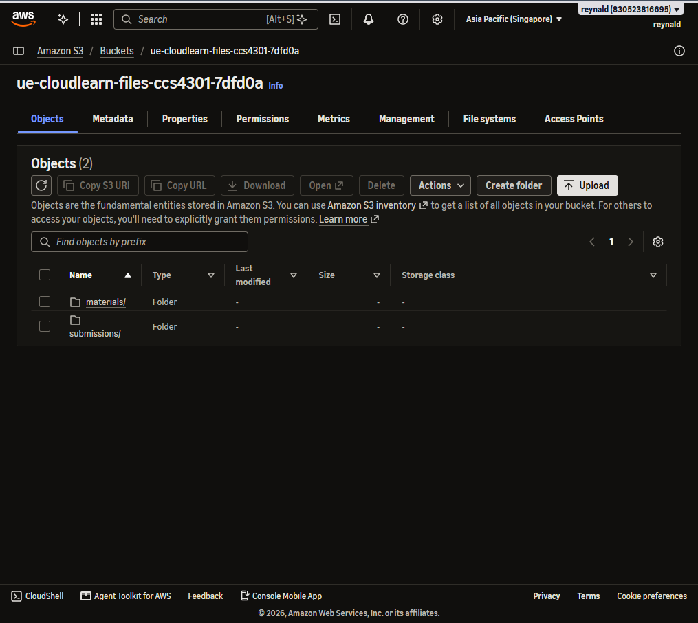
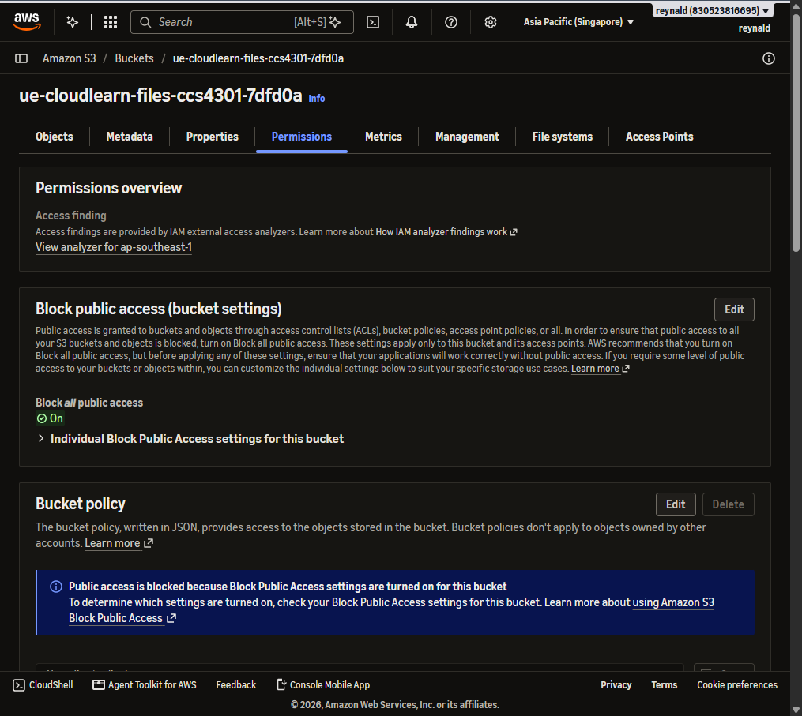
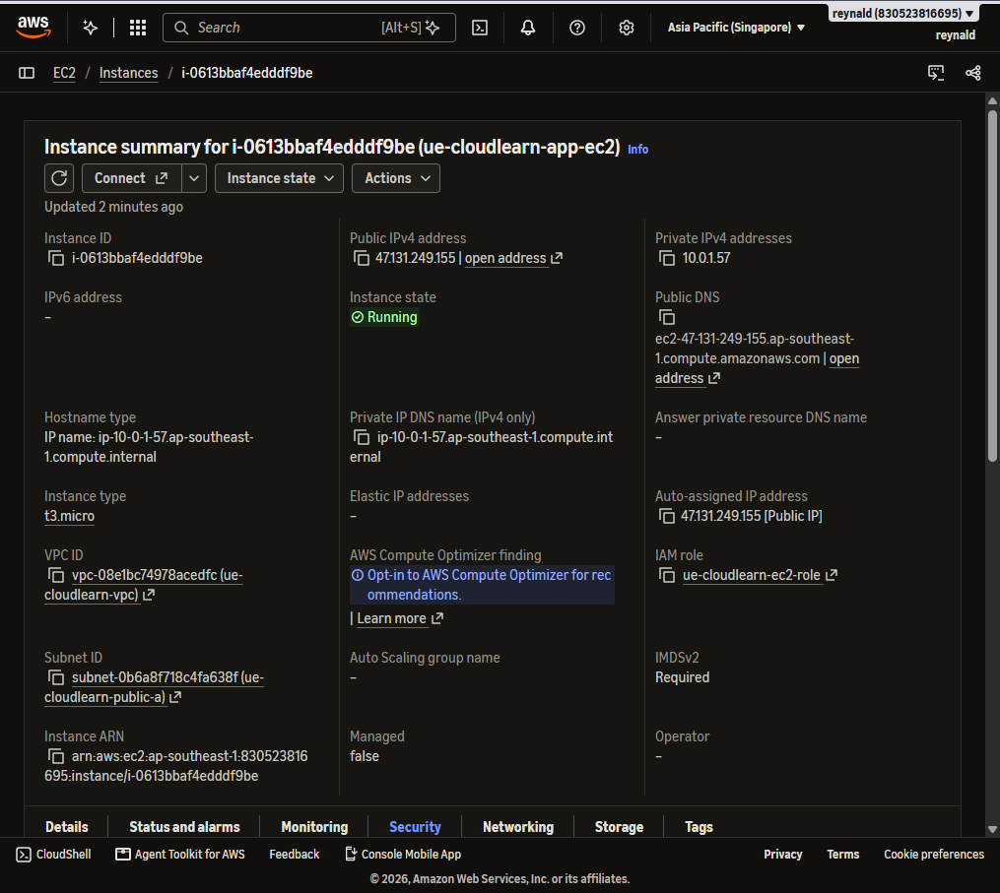
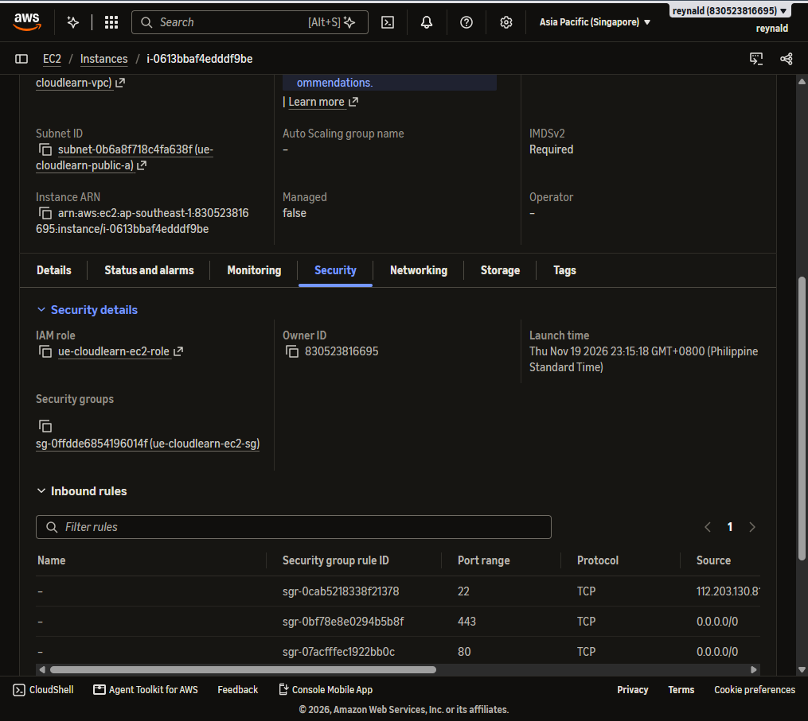
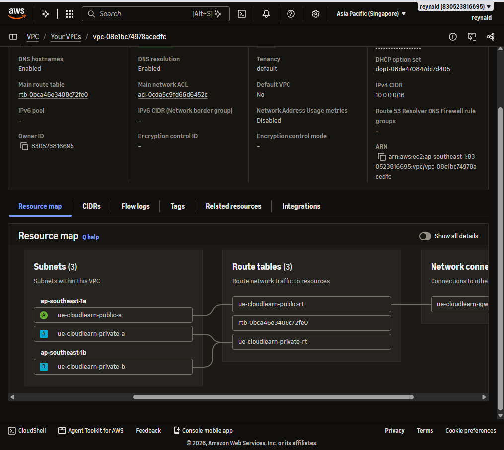
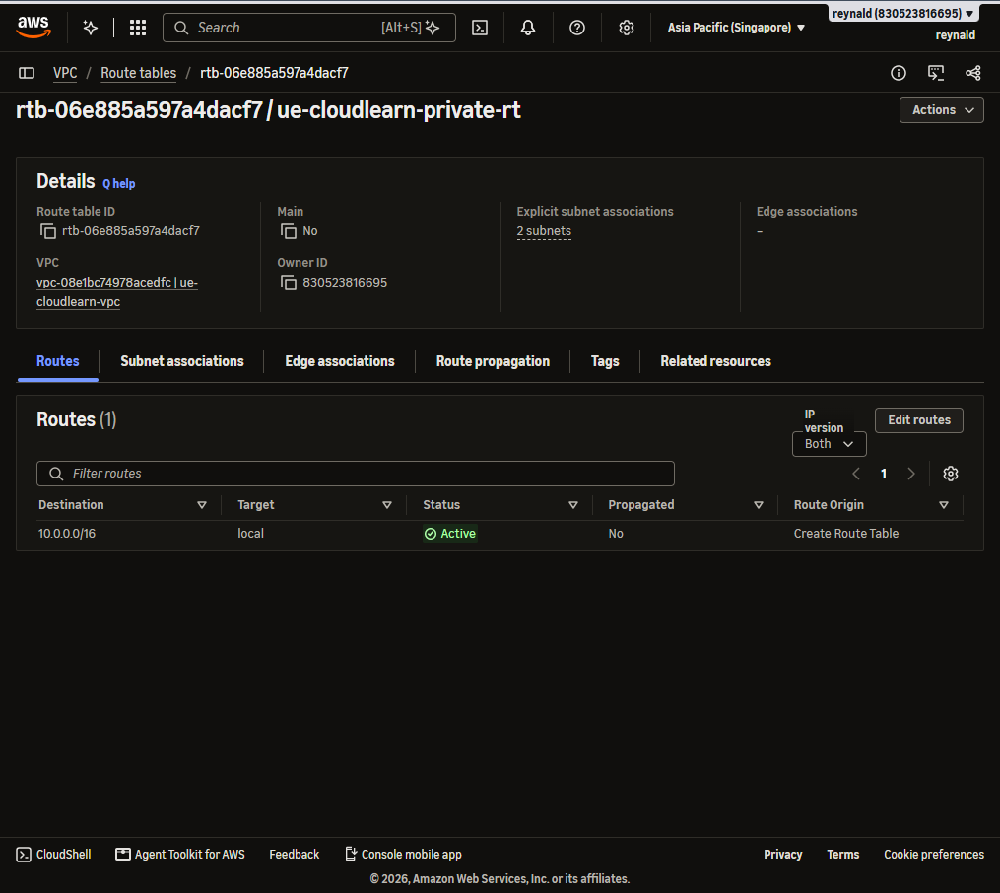
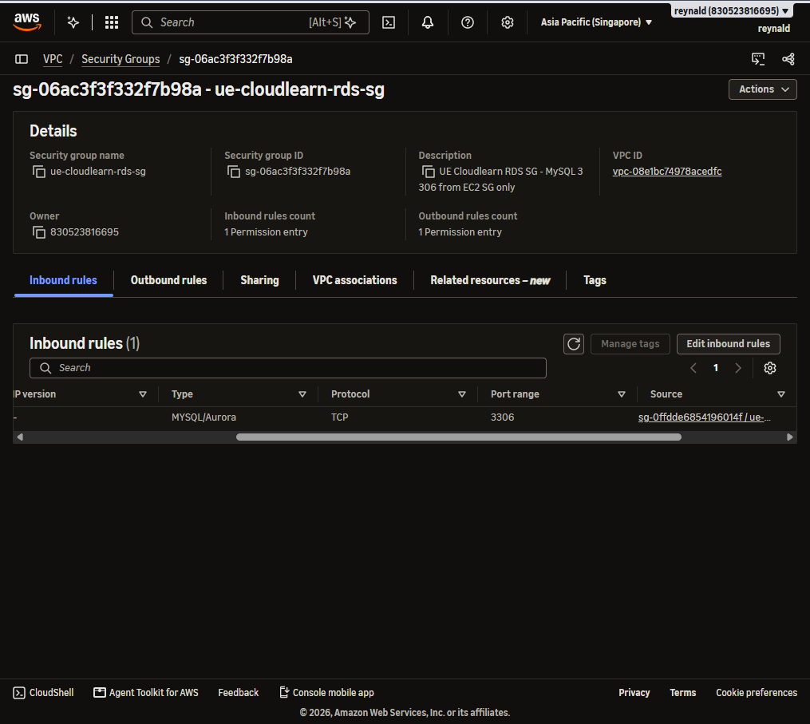
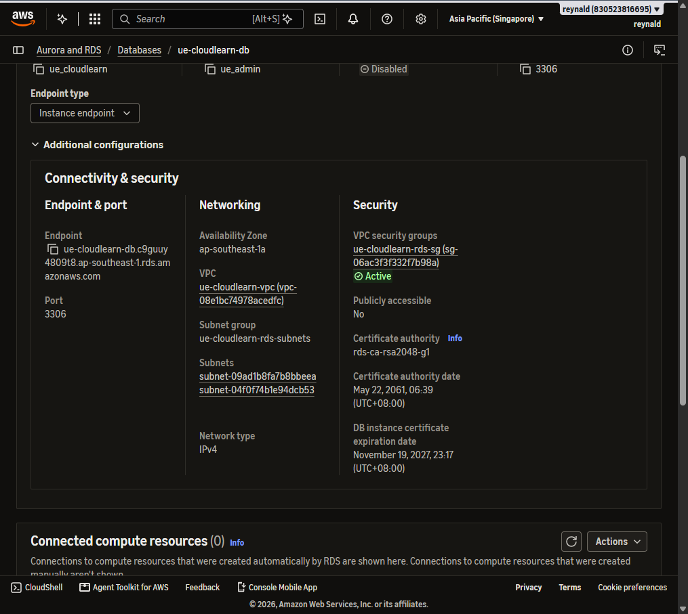
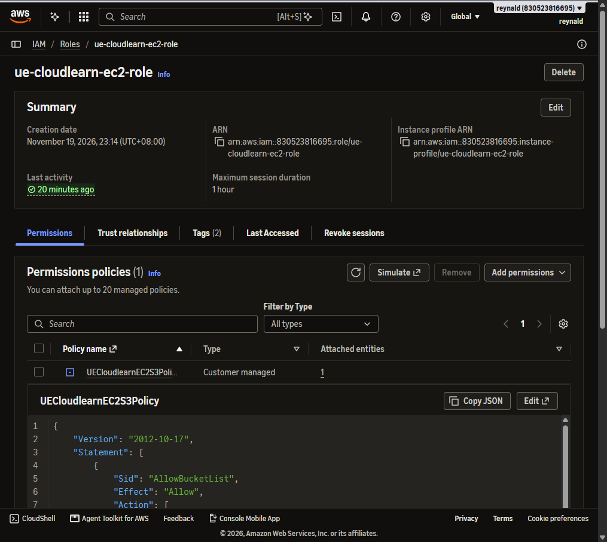
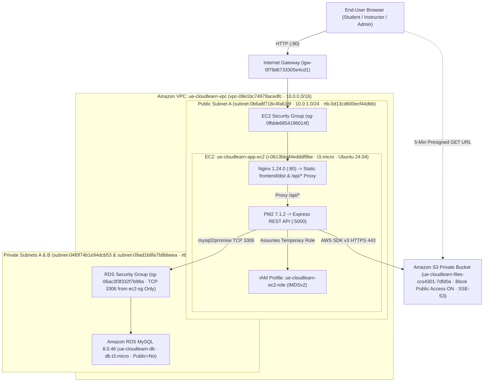

# CHAPTER 5: AWS CLOUD INFRASTRUCTURE AND DEPLOYMENT

## 5.1 AWS Environment Overview

UE Cloudlearn is deployed in the **Asia Pacific (Singapore) `ap-southeast-1`** AWS region, selected to minimize round-trip network latency between University of the East – Caloocan users in Metro Manila and AWS compute, database, and object storage endpoints. Every infrastructure component was provisioned under strict **AWS Free Tier** cost guardrails (`infra/aws-architecture-checklist.md` Section 1): single `t3.micro` EC2 instance, Single-AZ `db.t3.micro` RDS MySQL instance, standard S3 storage under 5 GB, zero NAT Gateways, zero Application Load Balancers, and zero unattached Elastic IPs.

Table 5.1 summarizes the complete non-secret live AWS resource ledger verified during production cloud deployment in `ap-southeast-1`. Per project security policy, 12-digit AWS Account IDs are redacted as `<ACCOUNT_ID>` and the restricted SSH source IP is redacted as `<OPERATOR_IP>/32`.

**Table 5.1**  
*Live AWS Free Tier Deployment Resource Ledger (`ap-southeast-1` Singapore)*

| AWS Service / Resource | Resource Name | Live AWS Identifier / Endpoint | Verified Status / Guardrail |
|---|---|---|---|
| **Amazon VPC** | `ue-cloudlearn-vpc` | `vpc-08e1bc74978acedfc` (`10.0.0.0/16`) | DNS support & hostnames enabled |
| **Public Subnet** | `ue-cloudlearn-public-a` | `subnet-0b6a8f718c4fa638f` (`10.0.1.0/24`, `ap-southeast-1a`) | Auto-assign public IPv4 ON; hosts EC2 |
| **Private Subnet A** | `ue-cloudlearn-private-a` | `subnet-04f0f74b1e94dcb53` (`10.0.2.0/24`, `ap-southeast-1a`) | Auto-assign public IPv4 OFF; RDS AZ 1 |
| **Private Subnet B** | `ue-cloudlearn-private-b` | `subnet-09ad1b8fa7b8bbeea` (`10.0.3.0/24`, `ap-southeast-1b`) | Auto-assign public IPv4 OFF; RDS AZ 2 |
| **Internet Gateway** | `ue-cloudlearn-igw` | `igw-0f79d6733305e4cd1` | Attached to `vpc-08e1bc74978acedfc` |
| **Public Route Table** | `ue-cloudlearn-public-rt` | `rtb-0d13cd600ecf44dbb` | `10.0.0.0/16 -> local`, `0.0.0.0/0 -> igw` |
| **Private Route Table** | `ue-cloudlearn-private-rt` | `rtb-06e885a597a4dacf7` | `10.0.0.0/16 -> local` ONLY (no NAT GW) |
| **EC2 Security Group** | `ue-cloudlearn-ec2-sg` | `sg-0ffdde6854196014f` | Inbound TCP `80/443` `0.0.0.0/0`, `22` `<OPERATOR_IP>/32` |
| **RDS Security Group** | `ue-cloudlearn-rds-sg` | `sg-06ac3f3f332f7b98a` | Inbound TCP `3306` ONLY from `sg-0ffdde6854196014f` |
| **Amazon S3 Bucket** | `ue-cloudlearn-files-ccs4301-7dfd0a` | `s3://ue-cloudlearn-files-ccs4301-7dfd0a` | Block All Public Access ON, SSE-S3 `AES256` |
| **AWS IAM Policy** | `UECloudlearnEC2S3Policy` | `arn:aws:iam::<ACCOUNT_ID>:policy/UECloudlearnEC2S3Policy` | Least-privilege S3 bucket/object actions only |
| **AWS IAM Role / Profile** | `ue-cloudlearn-ec2-role` | `arn:aws:iam::<ACCOUNT_ID>:instance-profile/ue-cloudlearn-ec2-role` | Verified via EC2 IMDSv2; zero static keys |
| **Amazon RDS (MySQL)** | `ue-cloudlearn-db` | `ue-cloudlearn-db.c9guuy4809t8.ap-southeast-1.rds.amazonaws.com:3306` | MySQL `8.0.46`, `db.t3.micro`, `PubliclyAccessible=false` |
| **Amazon EC2 Instance** | `ue-cloudlearn-app-ec2` | `i-0613bbaf4edddf9be` (`10.0.1.57`, initial `47.131.249.155` / resumed `54.255.186.17`) | Ubuntu 24.04 (`t3.micro`), Nginx + PM2 + 1 GB swap |

---

## 5.2 Amazon S3 Configuration

All course learning materials, optional assignment reference attachments, and student submission files reside in a single private **Amazon S3** bucket (`ue-cloudlearn-files-ccs4301-7dfd0a`) located in `ap-southeast-1`. Keeping binary objects out of MySQL prevents database bloat, preserves low-latency SQL queries, and separates object durability from EC2 instance lifetimes.

Bucket security enforces **Block All Public Access = ON** (all four public access block flags verified `true` via `aws s3api get-public-access-block`) and default server-side encryption **SSE-S3 (`AES256`)** (`aws s3api get-bucket-encryption`). No bucket policy grants anonymous read or write access. Instead, `backend/src/config/s3.js` uploads validated buffers (`<= 15 MB`) using `PutObjectCommand`, removes deleted artifacts via `DeleteObjectCommand`, and issues temporary 300-second (5-minute) presigned download URLs via `getSignedUrl(client, new GetObjectCommand(...), { expiresIn: 300 })` with `ResponseContentDisposition: attachment; filename="..."` strictly after JWT and course/owner authorization succeed. Table 5.2 documents the S3 prefix structure and live uploaded verification objects confirmed during live integration testing.

**Table 5.2**  
*Amazon S3 Bucket Configuration and Object Key Prefix Structure*

| Prefix / Setting | Specification / Live Verified Key Example | Security & Organization Purpose |
|---|---|---|
| **Materials Prefix** | `materials/course-{courseId}/{uuid}-{sanitizedFileName}` (e.g., `materials/course-1/ffe53225-2ab6-4e7b-b3b7-0e738e637433-ccs4301-live-s3-handout.pdf`) | Organizes instructor uploads by course ID; UUID prevents filename collisions |
| **Assignments Prefix** | `assignments/course-{courseId}/{uuid}-{sanitizedFileName}` | Stores optional assignment reference handouts/rubrics |
| **Submissions Prefix** | `submissions/assignment-{assignmentId}/student-{studentId}/{uuid}-{sanitizedFileName}` (e.g., `submissions/assignment-4/student-4/bc7e3329-6dd0-433d-a6b3-f2690e1f5440-cruz-assignment-4-live.pdf`) | Isolates student deliverables by assignment and student ID |
| **Public Access & Encryption** | Block All Public Access (`4/4` flags `true`), Default Encryption `SSE-S3 (AES256)` | Direct object URLs return `HTTP 403 AccessDenied`; presigned URLs expire after `300s` |

Figures 5.1 and 5.2 display the live S3 object hierarchy and Block Public Access settings in the AWS Management Console.



*Figure 5.1: Amazon S3 Private Bucket (`ue-cloudlearn-files-ccs4301-7dfd0a`) Objects and Prefix Hierarchy.*



*Figure 5.2: Amazon S3 Block All Public Access Configuration.*

---

## 5.3 Amazon EC2 Configuration

Application hosting runs on a single AWS Free Tier **Amazon EC2** instance (`ue-cloudlearn-app-ec2`, instance ID `i-0613bbaf4edddf9be`) launched in `ue-cloudlearn-public-a` (`ap-southeast-1a`) using **Ubuntu Server 24.04 LTS** (`ami-071c84f5b32b09602`). To ensure reliable Vite production builds on 1 GiB RAM without OOM termination, `infra/scripts/ec2-bootstrap.sh` provisions a persistent 1 GB `/swapfile` alongside **Node.js `v20.20.2`**, **npm `10.8.2`**, **Nginx `1.24.0`**, **MySQL client `8.0.46`**, and **PM2 `7.1.2`**.

Nginx (`infra/nginx/ue-cloudlearn.conf`) listens on port `80` with `client_max_body_size 16M` (supporting 15 MB uploads plus `multipart/form-data` overhead), serves `frontend/dist` directly with 1-year immutable caching on `/assets/` and `no-cache` on `/index.html`, enforces baseline security headers (`X-Content-Type-Options: nosniff`, `X-Frame-Options: SAMEORIGIN`, `Referrer-Policy: strict-origin-when-cross-origin`), and reverse-proxies `/api/*` requests intact to `http://127.0.0.1:5000`. PM2 (`infra/pm2/ecosystem.config.cjs`) runs `backend/src/server.js` with `autorestart: true`, `max_memory_restart: '350M'`, and `pm2-ubuntu.service` registered via `systemd` for automatic recovery across instance reboots. Table 5.3 summarizes the EC2 specifications, and Figures 5.3 and 5.4 depict the running EC2 summary and attached security/IAM configuration.

**Table 5.3**  
*Amazon EC2 Instance Specifications and Runtime Stack (`ue-cloudlearn-app-ec2`)*

| Attribute | Verified Value | Notes |
|---|---|---|
| **Instance ID & Name** | `i-0613bbaf4edddf9be` (`ue-cloudlearn-app-ec2`) | Running in `ap-southeast-1a` (`subnet-0b6a8f718c4fa638f`) |
| **Instance Type & AMI** | `t3.micro` (2 vCPU, 1 GiB RAM), `ami-071c84f5b32b09602` | Ubuntu 24.04 LTS + 20 GB `gp3` (`DeleteOnTermination=true`) + 1 GB `/swapfile` |
| **Network Addressing** | Private IP `10.0.1.57`; Initial Public IP `47.131.249.155` -> Resumed Public IP `54.255.186.17` | No paid Elastic IP; public IPv4 refreshes on stop/start |
| **Web Server & Process Manager** | `nginx/1.24.0` + `PM2 7.1.2` (`ue-cloudlearn-api`) | Nginx port `80` -> Express `127.0.0.1:5000`; `pm2-ubuntu.service` enabled |
| **Metadata & Identity** | `HttpTokens=required` (IMDSv2) + `ue-cloudlearn-ec2-role` | Zero AWS credentials stored in `/var/www/ue-cloudlearn/.env` (`chmod 600`) |



*Figure 5.3: Amazon EC2 Instance (`ue-cloudlearn-app-ec2` / `i-0613bbaf4edddf9be`) Running Summary.*



*Figure 5.4: Amazon EC2 Security Group and IAM Instance Profile Attachment.*

---

## 5.4 Amazon VPC Configuration

Network boundaries are governed by a custom **Amazon VPC** (`ue-cloudlearn-vpc`, `vpc-08e1bc74978acedfc`) allocated the `10.0.0.0/16` CIDR block with both **DNS resolution** (`enableDnsSupport = true`) and **DNS hostnames** (`enableDnsHostnames = true`) enabled so EC2 resolves private RDS DNS endpoints inside the VPC. As detailed in Table 5.4, the address space is divided into one public subnet (`ue-cloudlearn-public-a`) hosting EC2 and two private subnets (`ue-cloudlearn-private-a` and `ue-cloudlearn-private-b`) spanning two Availability Zones to satisfy Amazon RDS DB Subnet Group requirements.

Crucially, `ue-cloudlearn-private-rt` (`rtb-06e885a597a4dacf7`) contains **only** the local VPC route (`10.0.0.0/16 -> local`). No Internet Gateway route and no NAT Gateway are attached to the private subnets, guaranteeing both zero internet exposure for RDS and `$0.00` routing cost under AWS Free Tier. Figures 5.5 and 5.6 capture the live VPC Resource Map and Route Table rules.

**Table 5.4**  
*Amazon VPC Subnet Allocation and Route Table Associations (`ue-cloudlearn-vpc`)*

| Subnet Name & ID | CIDR Block & AZ | Public IPv4 Auto-Assign | Associated Route Table & Routes | Hosted Tier |
|---|---|---|---|---|
| `ue-cloudlearn-public-a` (`subnet-0b6a8f718c4fa638f`) | `10.0.1.0/24` (`ap-southeast-1a`) | Enabled (`ON`) | `ue-cloudlearn-public-rt` (`rtb-0d13cd600ecf44dbb`): `10.0.0.0/16 -> local`, `0.0.0.0/0 -> igw-0f79d6733305e4cd1` | Amazon EC2 Application Host |
| `ue-cloudlearn-private-a` (`subnet-04f0f74b1e94dcb53`) | `10.0.2.0/24` (`ap-southeast-1a`) | Disabled (`OFF`) | `ue-cloudlearn-private-rt` (`rtb-06e885a597a4dacf7`): `10.0.0.0/16 -> local` ONLY | Amazon RDS Subnet Group (AZ 1) |
| `ue-cloudlearn-private-b` (`subnet-09ad1b8fa7b8bbeea`) | `10.0.3.0/24` (`ap-southeast-1b`) | Disabled (`OFF`) | `ue-cloudlearn-private-rt` (`rtb-06e885a597a4dacf7`): `10.0.0.0/16 -> local` ONLY | Amazon RDS Subnet Group (AZ 2) |



*Figure 5.5: Amazon VPC (`ue-cloudlearn-vpc` / `vpc-08e1bc74978acedfc`) Visual Resource Map Across Availability Zones.*



*Figure 5.6: Public and Private Route Tables Configuration (`rtb-0d13cd600ecf44dbb` and `rtb-06e885a597a4dacf7`).*

---

## 5.5 Security Groups Configuration

Stateful virtual firewall rules operate at the instance network interface level via two linked **Security Groups** (`ue-cloudlearn-ec2-sg` and `ue-cloudlearn-rds-sg`). Rather than opening MySQL port `3306` to `0.0.0.0/0` or hardcoding private IP addresses, `ue-cloudlearn-rds-sg` (`sg-06ac3f3f332f7b98a`) uses **Security Group referencing**, accepting inbound MySQL traffic exclusively from network interfaces associated with `sg-0ffdde6854196014f`. SSH administration on EC2 is likewise restricted to `<OPERATOR_IP>/32`. Table 5.5 details every inbound and outbound rule, illustrated in Figure 5.7.

**Table 5.5**  
*Security Group Inbound and Outbound Rules (`ue-cloudlearn-ec2-sg` and `ue-cloudlearn-rds-sg`)*

| Security Group | Direction | Protocol & Port | Source / Destination | Operational Justification |
|---|---|---|---|---|
| `ue-cloudlearn-ec2-sg` (`sg-0ffdde6854196014f`) | **Inbound** | TCP `80` | `0.0.0.0/0` | Public HTTP access to Nginx web application |
| `ue-cloudlearn-ec2-sg` (`sg-0ffdde6854196014f`) | **Inbound** | TCP `443` | `0.0.0.0/0` | Optional HTTPS/TLS ingress endpoint |
| `ue-cloudlearn-ec2-sg` (`sg-0ffdde6854196014f`) | **Inbound** | TCP `22` | `<OPERATOR_IP>/32` | Restricted SSH administration from authorized operator IP only |
| `ue-cloudlearn-ec2-sg` (`sg-0ffdde6854196014f`) | **Outbound** | All Traffic | `0.0.0.0/0` | Permits OS/npm updates, HTTPS `443` S3 API calls, and TCP `3306` to RDS |
| `ue-cloudlearn-rds-sg` (`sg-06ac3f3f332f7b98a`) | **Inbound** | TCP `3306` | `sg-0ffdde6854196014f` (`ue-cloudlearn-ec2-sg`) | Restricts MySQL access exclusively to the EC2 backend tier |
| `ue-cloudlearn-rds-sg` (`sg-06ac3f3f332f7b98a`) | **Outbound** | Default | VPC / Stateful return | Security group statefulness permits query replies back to EC2 |



*Figure 5.7: Security Groups (`sg-0ffdde6854196014f` and `sg-06ac3f3f332f7b98a`) Inbound and Outbound Rules.*

---

## 5.6 Amazon RDS Configuration

The relational persistence layer runs on **Amazon RDS** instance `ue-cloudlearn-db` inside DB Subnet Group `ue-cloudlearn-rds-subnets` (`subnet-04f0f74b1e94dcb53` and `subnet-09ad1b8fa7b8bbeea`), configured with `PubliclyAccessible = false`, `MultiAZ = false`, `20 GB gp2` storage, backup retention `0`, and `ue-cloudlearn-rds-sg`. Table 5.6 lists the exact verified RDS attributes, and Figure 5.8 displays the RDS connectivity and security tab in the AWS Console.

**Table 5.6**  
*Amazon RDS Instance Configuration (`ue-cloudlearn-db`)*

| Setting | Verified Configuration |
|---|---|
| **DB Identifier & Engine** | `ue-cloudlearn-db` — MySQL Community `8.0.46` (`InnoDB`) |
| **Compute & Storage** | `db.t3.micro`, Single-AZ (`MultiAZ = false`), `20 GB gp2` |
| **Network Placement** | `ue-cloudlearn-vpc`, DB Subnet Group `ue-cloudlearn-rds-subnets` (Private Subnets A & B) |
| **Public Accessibility** | `false` (no public IP assigned; external TCP `3306` verified `ETIMEDOUT`) |
| **Security Group** | `ue-cloudlearn-rds-sg` (`sg-06ac3f3f332f7b98a`) |



*Figure 5.8: Amazon RDS Private Database Instance (`ue-cloudlearn-db`) Configuration.*

---

## 5.7 AWS IAM Configuration

To guarantee that permanent AWS Access Key IDs or Secret Access Keys are never placed in Git or on the EC2 filesystem, authentication between Express (`@aws-sdk/client-s3`) and Amazon S3 relies exclusively on an **AWS IAM Role and Instance Profile** (`ue-cloudlearn-ec2-role`). Following the principle of least privilege, `UECloudlearnEC2S3Policy` grants only `s3:ListBucket` on the bucket ARN and `s3:GetObject`, `s3:PutObject`, and `s3:DeleteObject` on objects inside `ue-cloudlearn-files-ccs4301-7dfd0a` (rather than `AmazonS3FullAccess` or `*` resources).

At runtime, the AWS SDK v3 default credential provider chain retrieves short-lived, automatically rotated temporary security credentials from the EC2 Instance Metadata Service (`IMDSv2` enforced with `HttpTokens=required`). Table 5.7 summarizes the IAM artifacts, followed by the exact trust and permissions policies (`infra/iam/ec2-trust-policy.json` and `UECloudlearnEC2S3Policy`) and Figure 5.9 showing the live IAM role configuration.

**Table 5.7**  
*AWS IAM Role (`ue-cloudlearn-ec2-role`) and Policy (`UECloudlearnEC2S3Policy`) Scope*

| IAM Resource | Name / Redacted ARN | Scope & Security Enforcement |
|---|---|---|
| **Trust Policy** | `infra/iam/ec2-trust-policy.json` | Allows `sts:AssumeRole` solely for principal `ec2.amazonaws.com` |
| **Customer Managed Policy** | `UECloudlearnEC2S3Policy` (`arn:aws:iam::<ACCOUNT_ID>:policy/UECloudlearnEC2S3Policy`) | Grants ONLY `s3:ListBucket` (bucket) and `s3:GetObject`, `s3:PutObject`, `s3:DeleteObject` (`/*`) for `ue-cloudlearn-files-ccs4301-7dfd0a` |
| **IAM Role & Instance Profile** | `ue-cloudlearn-ec2-role` (`arn:aws:iam::<ACCOUNT_ID>:instance-profile/ue-cloudlearn-ec2-role`) | Attached to `i-0613bbaf4edddf9be`; verified via `verify-live.sh` IMDSv2 check |

```json
{
  "Version": "2012-10-17",
  "Statement": [
    {
      "Sid": "AllowEC2AssumeRole",
      "Effect": "Allow",
      "Principal": { "Service": "ec2.amazonaws.com" },
      "Action": "sts:AssumeRole"
    }
  ]
}
```

```json
{
  "Version": "2012-10-17",
  "Statement": [
    {
      "Sid": "AllowBucketList",
      "Effect": "Allow",
      "Action": [ "s3:ListBucket" ],
      "Resource": "arn:aws:s3:::ue-cloudlearn-files-ccs4301-7dfd0a"
    },
    {
      "Sid": "AllowObjectCRUD",
      "Effect": "Allow",
      "Action": [ "s3:GetObject", "s3:PutObject", "s3:DeleteObject" ],
      "Resource": "arn:aws:s3:::ue-cloudlearn-files-ccs4301-7dfd0a/*"
    }
  ]
}
```



*Figure 5.9: AWS IAM Role (`ue-cloudlearn-ec2-role`) and Least-Privilege S3 Policy (`UECloudlearnEC2S3Policy`).*

---

## 5.8 AWS Service Integration

All provisioned AWS services operate as a coordinated architecture inside `ap-southeast-1`, as illustrated in Figure 5.10. Public HTTP requests traverse `igw-0f79d6733305e4cd1` and `sg-0ffdde6854196014f` into Nginx on EC2 `i-0613bbaf4edddf9be`. Static React routes load directly from `frontend/dist`, while API requests proxy to Express (`127.0.0.1:5000`), which executes `?`-parameterized MySQL queries over TCP `3306` through `sg-06ac3f3f332f7b98a` to private RDS `ue-cloudlearn-db` and exchanges files with private S3 bucket `ue-cloudlearn-files-ccs4301-7dfd0a` using temporary IAM credentials from `ue-cloudlearn-ec2-role`.



*Figure 5.10: Deployed AWS Production Topology and Service Integration Diagram in `ap-southeast-1`.*

---

## 5.9 Application Deployment and Free Tier Operations

### 5.9.1 Reproducible Cloud Deployment Pipeline

Deployment on Ubuntu 24.04 EC2 is automated via three LF-encoded scripts in `infra/scripts/`:

1. **Source Delivery:** A clean Linux LF source package from the repository (`https://github.com/rocumen/UE-Cloudlearn`) was deployed into `/var/www/ue-cloudlearn` with strict LF line endings on shell scripts.
2. **Host Bootstrap (`infra/scripts/ec2-bootstrap.sh`):** Idempotently configured 1 GB `/swapfile`, installed `nginx`, `mysql-client`, Node.js `v20.20.2`, and global `PM2 7.1.2`, and prepared `/var/www/ue-cloudlearn`.
3. **Production `.env` & Database Setup:** Created `/var/www/ue-cloudlearn/.env` (`chmod 600`) pointing to `ue-cloudlearn-db.c9guuy4809t8.ap-southeast-1.rds.amazonaws.com:3306`, `CORS_ORIGIN=http://47.131.249.155` (updated automatically to `http://54.255.186.17` upon instance resume), `COOKIE_SECURE=false` (configurable HTTP cookie security policy for the EC2 IPv4 endpoint), `S3_BUCKET_NAME=ue-cloudlearn-files-ccs4301-7dfd0a`, and zero AWS keys; executed `schema.sql`, `seed.sql`, and `npm run seed:passwords`.
4. **Build, Proxy & Process Launch (`infra/scripts/deploy.sh`):** Ran backend `npm ci --omit=dev`, compiled the Vite TypeScript bundle (`NODE_OPTIONS="--max-old-space-size=768" npm run build` completed in `5.42s`), activated `infra/nginx/ue-cloudlearn.conf` (`nginx -t` clean), started PM2 via `infra/pm2/ecosystem.config.cjs`, enabled `pm2-ubuntu.service`, and executed `infra/scripts/verify-live.sh`.
5. **Post-Deploy Live Verification (`infra/scripts/verify-live.sh`):** Confirmed all five runtime checks passed: PM2 `online`, Nginx `active`, `/api/health` returning `{"status":"ok","db":"connected"}`, root `/` returning `HTTP/1.1 200 OK`, and IMDSv2 confirming attached IAM role `ue-cloudlearn-ec2-role`.

### 5.9.2 Free Tier Pause and Resume Workflow (Pre-Defense Optimization)

Under the Free Tier pause-and-resume strategy documented in `infra/aws-architecture-checklist.md` Section 5, after completing initial live verification at `http://47.131.249.155` and capturing all 23 live screenshots, EC2 (`i-0613bbaf4edddf9be`) and RDS (`ue-cloudlearn-db`) can be safely stopped between screenshot capture and the **November 27, 2026** final presentation to preserve Free Tier compute hours (`750 hrs/month`) while keeping all RDS tables and S3 objects intact (`aws ec2 stop-instances` and `aws rds stop-db-instance`). Note two documented operational behaviors, both verified during a live overnight pause-and-resume cycle on `2026-11-20` (resuming smoothly at `http://54.255.186.17`):

- **7-Day Automatic RDS Restart:** AWS automatically restarts a stopped RDS instance after 7 days (ensuring RDS remains ready ahead of final defense rehearsal).
- **Dynamic EC2 Public IPv4 Refresh:** Because no paid or unattached Elastic IP is allocated, starting EC2 (`i-0613bbaf4edddf9be`) assigns a fresh public IPv4 address (transitioning from initial deployment `47.131.249.155` to `54.255.186.17` on the `2026-11-20` resume test). Upon resuming on November 26/27, the deployment lead retrieves the new public IP via `aws ec2 describe-instances`, authorizes SSH (`22`) if operator IP changed, updates `CORS_ORIGIN=http://<NEW_EC2_PUBLIC_IP>` in `/var/www/ue-cloudlearn/.env`, and runs `pm2 restart ue-cloudlearn-api --update-env` followed by `bash /var/www/ue-cloudlearn/infra/scripts/verify-live.sh`.
